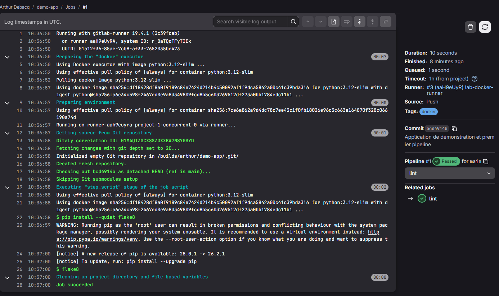
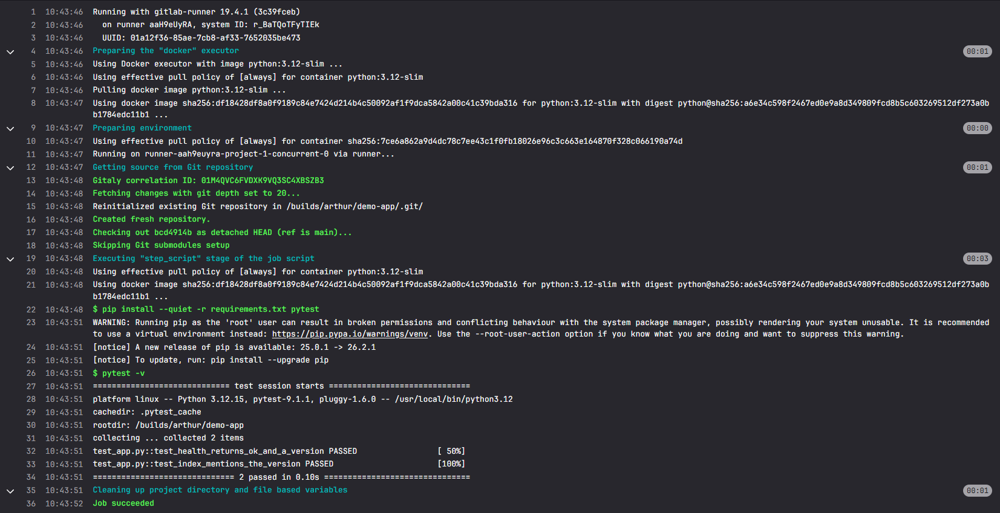
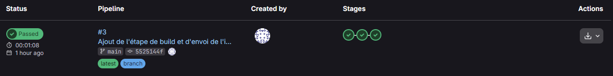
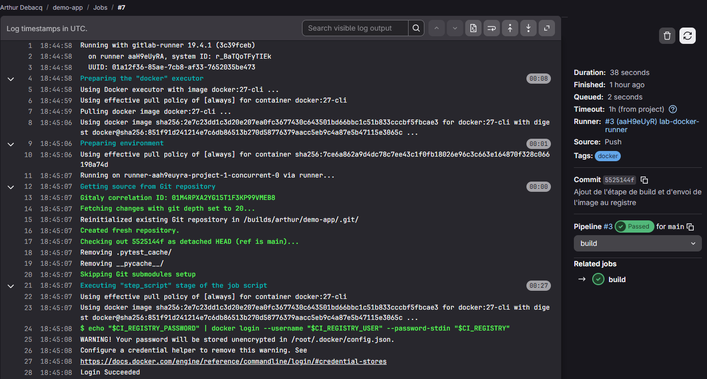
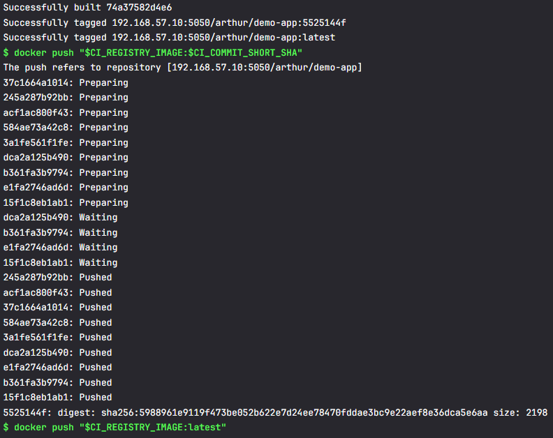
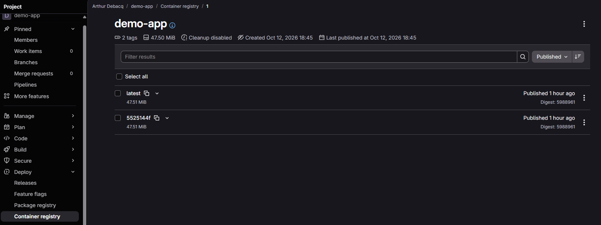
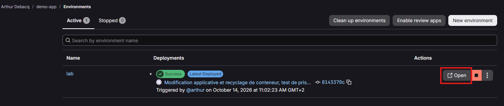

# Lab CI/CD Pipeline — GitLab CE auto-hébergé

> Une plateforme CI/CD complète et auto-hébergée (GitLab CE, GitLab Runner, cible de déploiement Docker), **entièrement construite par du code** (Vagrant + Ansible) : à chaque `git push`, l'application est vérifiée, empaquetée en image Docker et déployée automatiquement.

## En bref

- **Ce que c'est** : trois machines virtuelles (GitLab CE, un runner, une cible de déploiement), installées, configurées et sécurisées par Ansible, sur un réseau privé.
- **Ce que fait le pipeline** : `lint` → `test` → `build` (image Docker poussée dans le registre de GitLab) → `deploy` (lancement sur la cible et test de fumée qui vérifie la version déployée).
- **Reproductible** : je détruis les trois VMs et je reconstruis tout, jusqu'à l'application en ligne, en **18 minutes**, avec **un seul** `ansible-playbook` et **aucune** action manuelle dans GitLab.
- **Sécurisé** : HTTPS par une autorité de certification interne, secrets chiffrés avec Ansible Vault, variables CI masquées et protégées, comptes dédiés, durcissement SSH et pare-feu.
- **Contrôlé** : idempotence vérifiée (`changed=0` au second passage), `ansible-lint` en profil `production`, rôle testé contre un faux serveur d'API avant usage.
- **Documenté** : chaque étape, chaque problème rencontré et sa résolution sont expliqués dans le [journal de bord](#journal-de-bord).

**Compétences mises en œuvre** : Ansible (rôles, Vault, handlers, délégation, API REST), administration de GitLab CE, GitLab CI/CD, Docker et registre de conteneurs, PKI et TLS, Vagrant sur VMware Workstation, diagnostic méthodique. [Liste détaillée](#compétences-démontrées).

## Sommaire

**L'essentiel**
- [Objectif](#objectif)
- [Architecture](#architecture)
- [Démarrage rapide](#démarrage-rapide)
- [Stack technique](#stack-technique)

**Pour aller plus loin**
- [Choix techniques](#choix-techniques)
- [Sécurité et limites](#sécurité-et-limites)
- [Structure du projet](#structure-du-projet)
- [Avancement](#avancement)
- [Journal de bord](#journal-de-bord)
  - [05/10/2026 — Démarrage du projet](#05102026--démarrage-du-projet)
  - [05/10/2026 (suite) — Diagnostic réseau : adaptateur VMnet2 sans adresse IP](#05102026-suite--diagnostic-réseau--adaptateur-vmnet2-sans-adresse-ip)
  - [05/10/2026 (suite) — Rôle common](#05102026-suite--rôle-common)
  - [06/10/2026 — Rôle gitlab : installation, durcissement, comptes admin](#06102026--rôle-gitlab--installation-durcissement-comptes-admin)
  - [07/10/2026 — Rôle runner : installation Docker, GitLab Runner, enregistrement via API](#07102026--rôle-runner--installation-docker-gitlab-runner-enregistrement-via-api)
  - [08/10/2026 — Rôle deploy_target : Docker et compte de déploiement dédié](#08102026--rôle-deploy_target--docker-et-compte-de-déploiement-dédié)
  - [08/10/2026 – 09/10/2026 — PKI interne, GitLab en HTTPS et registre de conteneurs](#08102026--09102026--pki-interne-gitlab-en-https-et-registre-de-conteneurs)
  - [12/10/2026 — Application de démonstration et premier pipeline (lint et tests)](#12102026--application-de-démonstration-et-premier-pipeline-lint-et-tests)
  - [12/10/2026 (suite) — Pipeline : construire l'image Docker et l'envoyer au registre](#12102026-suite--pipeline--construire-limage-docker-et-lenvoyer-au-registre)
  - [13/10/2026 – 14/10/2026 — Pipeline : déploiement automatique sur deploy_target](#13102026--14102026--pipeline--déploiement-automatique-sur-deploy_target)
  - [15/10/2026 – 16/10/2026 — Test de reproductibilité complet depuis zéro](#15102026--16102026--test-de-reproductibilité-complet-depuis-zéro)
  - [23/10/2026 — Automatisation de l'amorçage de GitLab et nouveau test de reproductibilité](#23102026--automatisation-de-lamorçage-de-gitlab-et-nouveau-test-de-reproductibilité)
  - [23/10/2026 (suite) — Nettoyage du dépôt et documentation finale](#23102026-suite--nettoyage-du-dépôt-et-documentation-finale)
- [Compétences démontrées](#compétences-démontrées)
- Guide détaillé : [PKI interne, HTTPS et registre de conteneurs](doc/pki-et-https.md)

---

## Objectif

Deuxième projet de mon portfolio, dans la continuité de `lab-infra-as-code`. Je voulais aller au-delà de la rédaction d'un fichier `.gitlab-ci.yml` sur gitlab.com : **construire et administrer moi-même** une instance GitLab auto-hébergée, son runner et sa cible de déploiement, puis y faire tourner un pipeline de bout en bout.

L'accent est mis sur l'**infrastructure et l'administration système** (installation, durcissement, certificats, secrets, automatisation, reproductibilité). L'application déployée est volontairement minuscule (un service web qui renvoie sa version) : elle sert uniquement à prouver que la chaîne fonctionne.

## Architecture

```
                       git push
   Poste de contrôle ───────────────►┌───────────────────────────┐
   (WSL2 : Ansible)                  │ gitlab        192.168.57.10│
         │                           │ GitLab CE, registre :5050  │
         │ provisionne et configure  └─────────────┬─────────────┘
         │ les 3 VMs (Ansible)                     │ confie les jobs
         │                           ┌─────────────▼─────────────┐
         │                           │ runner        192.168.57.11│
         │                           │ GitLab Runner (Docker)     │
         │                           └─────────────┬─────────────┘
         │                                         │ déploie (Docker via SSH)
         │                           ┌─────────────▼─────────────┐
         └──────────────────────────►│ deploy_target 192.168.57.12│
                                     │ application :8000          │
                                     └───────────────────────────┘
```

| VM | Rôle | IP privée | RAM |
|---|---|---|---|
| gitlab | GitLab CE : dépôts, CI/CD, registre de conteneurs | 192.168.57.10 | 4 Go |
| runner | GitLab Runner, exécuteur Docker | 192.168.57.11 | 2 Go |
| deploy_target | Cible de déploiement (Docker) | 192.168.57.12 | 1 Go |

**Le pipeline** (application `demo-app`) :

| Étape | Ce qu'elle fait |
|---|---|
| `lint` | Analyse statique du code (`flake8`) |
| `test` | Tests automatisés (`pytest`) |
| `build` | Construction de l'image Docker, étiquetée avec l'identifiant du commit, et envoi dans le registre de GitLab |
| `deploy` | Remplacement du conteneur sur `deploy_target` par SSH, puis test de fumée : la version qui répond doit être celle du commit |

Toutes les communications avec GitLab se font en **HTTPS**, avec un certificat émis par une autorité de certification interne au lab. Réseau privé dédié `192.168.57.0/24`, distinct de celui de `lab-infra-as-code`.

## Démarrage rapide

### Prérequis

| Côté | Élément |
|---|---|
| Matériel | Environ 8 Go de RAM libres pour les VMs (projet réalisé sur un poste de 32 Go) |
| Windows | VMware Workstation Pro ; Vagrant avec le plugin `vagrant-vmware-desktop` et Vagrant VMware Utility |
| WSL2 (Ubuntu) | Ansible (ici installé avec `pipx`) ; client OpenSSH ; `direnv` si le projet est sur un disque Windows (`/mnt/c`, `/mnt/f`...) |

### 1. Préparer le poste de contrôle (une seule fois)

```bash
# Collections Ansible du projet
ansible-galaxy collection install -r requirements.yml

# Deux paires de clés SSH : administration des VMs, et déploiement par le pipeline
ssh-keygen -t ed25519 -f ~/.ssh/id_ed25519_lab -C "lab-cicd-pipeline"
ssh-keygen -t ed25519 -f ~/.ssh/id_ed25519_ci_deploy -N "" -C "lab-cicd-pipeline-deploy"

# Secrets : créer les fichiers Vault à partir des modèles, les remplir, puis les chiffrer
cp inventory/group_vars/all/vault.yml.example inventory/group_vars/all/vault.yml
cp inventory/group_vars/gitlab_server/vault.yml.example inventory/group_vars/gitlab_server/vault.yml
# (remplir : jeton de 20 caractères avec "openssl rand -hex 10", mots de passe avec "openssl rand -base64 20")
ansible-vault encrypt inventory/group_vars/all/vault.yml inventory/group_vars/gitlab_server/vault.yml

# Si le projet est sur un disque Windows : charger ansible.cfg automatiquement
direnv allow
```
Le nom du compte administrateur GitLab se règle dans `inventory/group_vars/gitlab_server/vars.yml`.

### 2. Construire l'environnement

```powershell
# PowerShell, à la racine du projet
vagrant up
```
```bash
# WSL2, à la racine du projet
./scripts/sync-vagrant-keys.sh
ansible-playbook site.yml --ask-vault-pass
```
Compter une dizaine de minutes pour le playbook (l'installation de GitLab est l'étape la plus longue). À la fin, GitLab est installé en HTTPS, le runner est enregistré, et le projet `demo-app` existe avec ses variables CI/CD.

### 3. Pousser l'application et la voir déployée

```bash
cp -r demo-app ~/demo-app && cd ~/demo-app
git config --global http.https://192.168.57.10/.sslCAInfo ~/.lab-pki/lab-cicd-pipeline/lab-ca.crt
git init -b main && git add . && git commit -m "Application de démonstration"
git remote add origin https://192.168.57.10/<compte-admin>/demo-app.git
git push -u origin main        # mot de passe : le jeton du Vault (ansible-vault view inventory/group_vars/all/vault.yml)
```
Le pipeline démarre seul. Une fois terminé :
```bash
curl http://192.168.57.12:8000/health      # {"status":"ok","version":"<identifiant du commit>"}
```
L'interface de GitLab est sur `https://192.168.57.10`. Pour que le navigateur accepte le certificat, importer la CA dans Windows (PowerShell administrateur) : `certutil -addstore -f "ROOT" <chemin vers lab-ca.crt>`.

### Reconstruire depuis zéro

`vagrant destroy -f`, puis les étapes 2 et 3. La CA, conservée dans `~/.lab-pki/`, est réutilisée : l'import dans Windows reste valable. Le jeton venant du Vault, il ne change pas non plus.

> **Si les VMs sont injoignables** (`No route to host`) : vérifier que l'adaptateur Windows du réseau VMware a bien une adresse dans `192.168.57.0/24` ([journal du 05/10/2026](#05102026-suite--diagnostic-réseau--adaptateur-vmnet2-sans-adresse-ip)).

## Stack technique

| Outil / Techno | Rôle dans le projet |
|---|---|
| VMware Workstation Pro | Hyperviseur (remplace VirtualBox, utilisé sur `lab-infra-as-code`) |
| Vagrant (provider `vmware_desktop`) | Provisioning des VMs par code |
| WSL2 (Ubuntu) | Poste de contrôle Ansible |
| Ansible | Configuration des VMs (rôles) |
| GitLab CE (Omnibus) | Dépôt Git, CI/CD, registre Docker intégré |
| GitLab Runner | Exécution des jobs CI/CD (exécuteur Docker) |
| Docker | Conteneurisation de l'application buildée et environnement du runner |
| GitLab Container Registry | Stockage des images Docker construites par le pipeline (HTTPS, port 5050) |
| `community.crypto` (Ansible) | PKI interne : génération de la CA et signature des certificats |
| Nginx (intégré à GitLab) | Terminaison TLS pour l'interface GitLab et pour le registre |
| API REST de GitLab (module Ansible `uri`) | Amorçage automatisé : création du projet et de ses variables CI/CD |
| `ansible-lint` (profil `production`) | Contrôle qualité du code Ansible |

---

## Choix techniques

- **VMware Workstation Pro plutôt que VirtualBox** : changement de matériel (nouveau PC, 32 Go RAM) permettant de monter en compétence sur un hyperviseur avec davantage de présence en entreprise (écosystème VMware ESXi/vSphere), tout en restant gratuit pour cet usage. `lab-infra-as-code` reste sur VirtualBox (projet déjà livré, aucun intérêt à le migrer).
- **GitLab CE auto-hébergé plutôt qu'une solution légère (Gitea/Drone)** : le nouveau PC lève la contrainte de ressources qui avait initialement motivé une solution allégée. GitLab est très largement utilisé en entreprise en France, et l'auto-hébergement ajoute une vraie dimension d'administration système (base de données interne, Nginx intégré, sauvegardes, mises à jour) en plus de la configuration CI/CD elle-même.
- **Réseau dédié séparé de `lab-infra-as-code`** : chaque projet reste un livrable autonome et indépendant, cohérent avec le principe "un repo = un projet démontrable".
- **Noms de groupes Ansible distincts des noms d'hôtes dès la conception** (`gitlab_server`, `ci_runners`, `deploy_targets` vs `gitlab`, `runner`, `deploy_target`) : leçon directement tirée de `lab-infra-as-code`, où l'ambiguïté groupe/hôte avait causé un bug de ciblage.
- **CA interne plutôt que certificats auto-signés** : un seul certificat racine à distribuer aux clients, et tout certificat émis ensuite est accepté d'office ; c'est le fonctionnement d'une PKI d'entreprise. Let's Encrypt est exclu (il exige un domaine public).
- **Registre en HTTPS plutôt qu'`insecure-registries`** : évite de désactiver la vérification de sécurité du démon Docker.
- **Clé privée de la CA générée sur le poste de contrôle** (`~/.lab-pki/`, hors dépôt Git et hors `/mnt/c`) : elle ne quitte jamais WSL2 et bénéficie de permissions Unix réelles.
- **Jeton d'API à valeur prédéfinie, rangé dans le Vault** : le secret naît dans le Vault et le playbook le crée dans GitLab, au lieu d'être généré dans l'interface puis recopié. Un seul `ansible-playbook` amène ainsi l'environnement jusqu'au déploiement.
- **API REST avec le module `uri` plutôt que les modules `community.general.gitlab_*`** : aucune dépendance Python supplémentaire, requêtes visibles, et idempotence maîtrisée (voir le journal du 23/10/2026).

## Sécurité et limites

**Ce qui est en place**

| Mesure | Détail |
|---|---|
| HTTPS de bout en bout vers GitLab | Autorité de certification interne, distribuée à tous les clients (système, Docker, GitLab, runner, Windows) |
| Secrets chiffrés | Ansible Vault pour les mots de passe et le jeton ; aucun secret en clair dans le dépôt |
| Variables CI protégées | Clé de déploiement masquée, cachée et réservée à la branche protégée `main` ; empreinte du serveur cible enregistrée à l'avance |
| Comptes dédiés | Compte d'administration nominatif sur GitLab (`root` gardé pour le secours), compte `deployer` et clé dédiés au déploiement |
| Durcissement des VMs | Connexion SSH par clé uniquement, pas de connexion `root`, pare-feu UFW restrictif, mises à jour de sécurité automatiques |
| Auto-inscription désactivée | Seul un administrateur crée des comptes sur GitLab |

**Les limites assumées** (lab personnel) **et ce que je ferais en production**

| Limite | Pourquoi | Piste |
|---|---|---|
| Docker contourne le pare-feu UFW | Docker publie le port 8000 par une redirection (DNAT) évaluée avant les règles d'UFW | Port publié sur `127.0.0.1` derrière un reverse proxy, ou règles dans la chaîne `DOCKER-USER` |
| Le groupe `docker` équivaut à `root` | Le runner partage le socket Docker de sa VM avec les jobs, et `deployer` peut lancer n'importe quel conteneur | Docker *rootless*, ou modèle GitOps où la cible récupère elle-même les nouvelles versions |
| La clé de déploiement vit dans une variable CI | Le masquage évite les fuites accidentelles dans les journaux, mais n'est pas un contrôle d'accès | Protection stricte de `main`, clé à portée limitée |
| Jeton d'API à longue durée de vie | Valable 360 jours, accès `api` complet au compte administrateur | Compte de service dédié, rotation régulière |
| Certificat serveur non renouvelé automatiquement | Valable 825 jours ; clé de la CA non chiffrée sur le poste de contrôle | Renouvellement automatisé ; CA racine hors ligne et CA intermédiaire |
| Accès par adresse IP, sans DNS | Plus simple dans un lab local | Nom DNS interne |
| Application servie en HTTP | Seul GitLab est en HTTPS ; l'application de démonstration écoute en clair sur le port 8000 | Reverse proxy TLS devant l'application |
| Brève interruption à chaque déploiement | Le conteneur est supprimé puis recréé | Déploiement progressif derrière un répartiteur de charge |
| Les images s'accumulent | Sur la cible et dans le registre (pas de politique de nettoyage) | Nettoyage des images inutilisées, politique de rétention |
| Docker 20.10 (paquet Debian) sur les VMs | Plus ancien que le client utilisé dans les jobs | Docker depuis le dépôt officiel |

## Structure du projet

```
lab-cicd-pipeline/
├── Vagrantfile                  Les 3 VMs (VMware Workstation, réseau 192.168.57.0/24)
├── site.yml                     Playbook principal : enchaîne tous les rôles
├── ansible.cfg
├── requirements.yml             Collections Ansible nécessaires
├── .envrc                       Charge ansible.cfg automatiquement (direnv)
├── .gitignore
├── inventory/
│   ├── hosts.ini                Machines et groupes
│   └── group_vars/
│       ├── cicd.yml             Connexion SSH aux VMs
│       ├── all/                 URL de l'API GitLab, jeton d'automatisation (Vault)
│       │   ├── vars.yml
│       │   ├── vault.yml        (chiffré)
│       │   └── vault.yml.example
│       └── gitlab_server/       Comptes GitLab (Vault)
│           ├── vars.yml
│           ├── vault.yml        (chiffré)
│           └── vault.yml.example
├── roles/
│   ├── pki/                     CA interne et certificat de GitLab (sur le poste de contrôle)
│   ├── common/                  Durcissement de base de toutes les VMs
│   ├── ca_trust/                Confiance système dans la CA interne
│   ├── gitlab/                  Installation, HTTPS, registre, comptes, jeton d'automatisation
│   ├── runner/                  Docker, GitLab Runner et son enregistrement
│   ├── docker_registry_trust/   Confiance de Docker dans le registre
│   ├── deploy_target/           Docker et compte de déploiement
│   └── gitlab_project/          Projet demo-app et variables CI/CD, par l'API de GitLab
├── demo-app/                    Application de démonstration et son pipeline (.gitlab-ci.yml)
├── scripts/
│   └── sync-vagrant-keys.sh     Copie les clés SSH des VMs vers WSL2
└── doc/
    ├── pki-et-https.md          Guide détaillé de la PKI et du HTTPS
    └── images/                  Captures citées dans le journal de bord
```

## Avancement

- [x] Vagrantfile — provisioning des 3 VMs (gitlab, runner, deploy_target) sur VMware Workstation Pro
- [x] Inventaire Ansible structuré, sans ambiguïté groupe/hôte
- [x] Rôle `common` (durcissement de base, repris de `lab-infra-as-code`)
- [x] Rôle d'installation de GitLab CE
- [x] Rôle d'installation et d'enregistrement du GitLab Runner
- [x] Préparation de la VM `deploy_target` (Docker, compte de déploiement dédié)
- [x] PKI interne et GitLab en HTTPS ([guide détaillé](doc/pki-et-https.md))
- [x] Registre de conteneurs GitLab activé, `runner` et `deploy_target` configurés pour lui faire confiance, validé par un `docker login`
- [x] Application de démonstration et pipeline : lint et tests automatiques
- [x] Pipeline : construction de l'image Docker et envoi vers le registre
- [x] Pipeline : déploiement automatique sur `deploy_target`, avec test de fumée sur la version
- [x] Test de reproductibilité complet depuis zéro (reconstruction des 3 VMs, rejeu du playbook puis du pipeline) : 29 min jusqu'au premier push
- [x] Vérification de l'idempotence de l'ensemble (`changed=0` partout)
- [x] Automatiser l'amorçage de GitLab (jeton, projet, variables CI/CD) et refaire le test : 18 min jusqu'à l'application en ligne, sans aucune action dans l'interface de GitLab
- [x] Contrôle qualité : `ansible-lint` en profil `production`
- [x] Nettoyage du dépôt (portabilité, modèles des fichiers Vault) et documentation finale

**Pistes d'amélioration** : les limites listées plus haut, et le contournement d'UFW par Docker, qui sera traité dans le projet de durcissement du portfolio (`lab-hardening-monitoring`).

## Journal de bord

### 05/10/2026 — Démarrage du projet

**Réalisé :**
- Repo `lab-cicd-pipeline` créé sur GitHub
- `Vagrantfile` écrit pour le provider `vmware_desktop` (box `generic/debian12`, multi-provider — contrairement à `debian/bookworm64` utilisée sur `lab-infra-as-code`, souvent limitée à VirtualBox)
- 3 VMs provisionnées avec succès dès le premier essai (`gitlab`, `runner`, `deploy_target`), aucune erreur liée au nouveau provider
- Structure Ansible initiale posée : inventaire, `ansible.cfg`, script de synchronisation des clés SSH (chemin adapté : `.vagrant/machines/<nom>/vmware_desktop/private_key`, différent du chemin VirtualBox)

**Contexte matériel et changement de stack :** passage à un nouveau PC (Windows 11, i7-12700F 12c/20t, 32 Go RAM, RTX 3060 Ti), qui lève la contrainte de ressources ayant guidé mes choix techniques sur `lab-infra-as-code`. Décision de changer d'hyperviseur (VMware Workstation Pro, plus proche de l'écosystème VMware d'entreprise que VirtualBox) et de viser GitLab CE auto-hébergé plutôt qu'une solution CI/CD allégée, maintenant que les ressources le permettent.

**Prochaine étape :** synchronisation des clés SSH, test de connectivité Ansible (`ansible all -m ping`), puis rôle `common`.

---

### 05/10/2026 (suite) — Diagnostic réseau : adaptateur VMnet2 sans adresse IP

**Symptôme :** `ansible all -m ping` échoue sur les 3 VMs avec :
```
Failed to connect to the host via ssh: ssh: connect to host 192.168.57.12 port 22: No route to host
```
Avant de corriger quoi que ce soit, premier réflexe : déterminer si le problème est spécifique à une VM ou touche tout le sous-réseau. Test ciblé sur les deux autres groupes (`ansible gitlab_server,ci_runners -m ping`) : échec identique sur les 3 VMs. Conclusion : le problème est en amont des VMs elles-mêmes, pas un souci de configuration individuelle.

**Démarche de diagnostic, en partant de la source (Windows) plutôt que de WSL2 :**

1. **`ping` depuis PowerShell** (pas WSL2, pour éliminer une couche d'abstraction) :
   ```
   ping 192.168.57.10
   → Réponse de 192.168.1.254 : Impossible de joindre l'hôte de destination.
   ```
   Révélateur : la réponse vient de `192.168.1.254` (la box/routeur du réseau domestique), pas d'une des VMs. Ça signifie que Windows **ne sait même pas qu'il doit router vers `192.168.57.0/24` via l'adaptateur VMware** — il part par la route par défaut (la box internet) à la place, qui renvoie logiquement une erreur de routage.

2. **Vérification de l'existence du réseau côté VMware** : l'éditeur de réseau virtuel (`vmnetcfg.exe`, lancé en administrateur) confirme que `VMnet2` existe bien, configuré en "Hôte uniquement", sous-réseau `192.168.57.0` — donc le réseau est correctement défini côté VMware. `ipconfig /all | findstr /i "VMnet"` confirme aussi la présence de l'adaptateur `VMware Network Adapter VMnet2` côté Windows. Jusqu'ici, tout semble correct en apparence — d'où l'intérêt de creuser un niveau plus loin plutôt que de s'arrêter à "l'adaptateur existe".

3. **Cause réelle, trouvée en inspectant l'adresse IP précise de l'adaptateur** (`ipconfig /all | Select-String -Pattern "VMnet2" -Context 0,8`, la commande précédente ayant filtré uniquement les lignes contenant "VMnet" et donc masqué l'information clé) : l'adaptateur `VMware Network Adapter VMnet2` avait une **adresse APIPA** (`169.254.x.x`) au lieu d'une adresse dans `192.168.57.0/24`. Sans IP valide dans le bon sous-réseau sur cet adaptateur, Windows n'a aucune route vers ce réseau, malgré un adaptateur et un réseau VMware tous les deux correctement configurés en apparence.

**Hypothèse sur l'origine** : probablement un résidu de la réinstallation complète du poste (nouveau PC) — le service d'attribution d'adresse sur l'adaptateur hôte-uniquement n'a pas correctement initialisé son IP lors de la création du réseau par Vagrant/VMware.

**Solution appliquée :**
```powershell
# Identifier le nom exact de l'interface
Get-NetAdapter | Where-Object {$_.InterfaceDescription -like "*VMnet2*"}

# Assigner une IP statique sur le bon sous-réseau
New-NetIPAddress -InterfaceAlias "<nom trouvé>" -IPAddress 192.168.57.1 -PrefixLength 24

# Redémarrer les services réseau VMware pour resynchroniser
Restart-Service "VMware NAT Service","VMware DHCP Service" -ErrorAction SilentlyContinue
```

**Résultat :** `ping 192.168.57.10` répond depuis Windows, puis depuis WSL2, puis `ansible all -m ping` répond `pong` sur les 3 VMs.

**Enseignement à retenir pour la suite du portfolio** : sur VMware Workstation (contrairement à VirtualBox, où le réseau host-only est généralement prêt à l'emploi dès sa création), **vérifier systématiquement l'adresse IP réelle de l'adaptateur hôte côté Windows** après la création d'un nouveau réseau privé — la simple présence de l'adaptateur et du réseau dans `vmnetcfg.exe` ne garantit pas qu'il soit fonctionnel.

**Prochaine étape :** rôle `common` (durcissement de base, repris de `lab-infra-as-code`).

---

### 05/10/2026 (suite) — Rôle `common`

**Réalisé :** rôle `common` repris tel quel de `lab-infra-as-code` (compte admin dédié `sysadmin`, durcissement SSH, pare-feu UFW, paquet `acl` inclus d'emblée cette fois — leçon directement intégrée dès l'écriture plutôt que découverte par erreur comme sur le projet précédent), appliqué aux 3 VMs via le groupe parent `cicd`.

**Résultat :** playbook exécuté avec succès du premier coup, aucune erreur. Idempotence vérifiée sur 3-4 relances consécutives, entièrement en `ok` sans `changed`.

**Prochaine étape :** rôle d'installation de GitLab CE (Omnibus) sur la VM `gitlab`.

---

### 06/10/2026 — Rôle `gitlab` : installation, durcissement, comptes admin

Session la plus riche en dépannage du projet jusqu'ici — six problèmes distincts, chacun avec une cause réelle différente de ce que le message d'erreur laissait penser au premier abord. Détail complet ci-dessous, volontairement exhaustif : c'est le genre d'enchaînement qui démontre une vraie capacité de diagnostic en entretien.

**Réalisé :**
- Rôle `gitlab` : dépôt APT officiel (format moderne `deb822_repository`), installation du paquet `gitlab-ce`, configuration minimale via `gitlab.rb` (URL externe, monitoring Prometheus intégré désactivé pour alléger l'empreinte sur les 4 Go alloués)
- Durcissement : désactivation de l'auto-inscription des nouveaux utilisateurs
- Comptes : mot de passe root permanent + création d'un compte admin nominatif (`arthur`), tous deux gérés via Ansible Vault — `root` reste un compte de secours ("break-glass"), jamais utilisé au quotidien

**Problème n°1 — Dépréciations Ansible (non bloquantes, mais à corriger avant qu'elles cassent réellement le playbook dans une future version d'ansible-core) :**
- `ansible.builtin.apt_repository` déprécié au profit de `ansible.builtin.deb822_repository`, le nouveau format de dépôt APT. Bonus : ce module gère nativement la récupération de la clé GPG via son paramètre `signed_by`, ce qui a permis de supprimer une tâche entière (téléchargement + `gpg --dearmor` manuel) et la dépendance au paquet `gnupg`.
- `ansible_distribution_release` (fact "nue", injectée automatiquement) remplacée par `ansible_facts['distribution_release']`, la syntaxe que les versions futures d'Ansible vont exiger (`INJECT_FACTS_AS_VARS` sera retiré).

**Problème n°2 — Deux bannières de sécurité affichées par GitLab lui-même, à ne pas confondre avec des bugs :**
- *"Check the restrictions for new users"* : l'auto-inscription publique est activée par défaut. Risque réel si l'instance était exposée à Internet ; même en lab privé, c'est la pratique standard en entreprise de la désactiver (comptes créés uniquement par un admin). Corrigé via une tâche `gitlab-rails runner` — ce réglage vit en base de données (`application_settings`), pas dans `gitlab.rb`, donc impossible à poser en infrastructure-as-code classique.
- *"Web IDE single origin fallback is enabled"* : nécessite un second nom de domaine dédié pour une isolation complète, ce qui n'a pas de sens dans un lab local sans DNS. Volontairement laissé tel quel — compromis assumé, pas un oubli.

**Problème n°3 — Timing des handlers Ansible :** la tâche de durcissement (`gitlab-rails runner ... signup_enabled: false`) échouait uniquement sur une VM neuve (jamais en relance), avec une erreur trompeuse (`could not load /opt/gitlab/etc/gitlab-rails-rc`). Cause : **les handlers Ansible ne s'exécutent qu'en toute fin de play**, pas immédiatement au moment où ils sont notifiés. Sur une première installation, toutes les tâches s'exécutaient donc avant que `gitlab-ctl reconfigure` (déclenché par le handler suite au dépôt de `gitlab.rb`) n'ait réellement eu lieu. Diagnostiqué en observant qu'inverser l'ordre des tâches à la main réglait le symptôme — corrigé proprement avec `ansible.builtin.meta: flush_handlers`, placé juste après la tâche qui notifie le handler, pour forcer son exécution immédiate sans dépendre de l'ordre du fichier.

**Problème n°4 — Permissions `git` vs `root` :** la tâche de création du compte admin échouait avec *"le fichier ... pourrait ne pas être trouvé"*, alors que le fichier existait bel et bien. Cause : `gitlab-rails runner`, même invoqué par une tâche Ansible avec `become: true` (root), **bascule en interne vers l'utilisateur système `git`** (celui sous lequel tourne l'application GitLab) pour exécuter le code Rails. Le dossier de dépôt du script (`/opt/gitlab-bootstrap`) était en mode `0750` (root + groupe root uniquement) — l'utilisateur `git` n'avait aucun droit de traversée, d'où une erreur trompeuse ("introuvable" plutôt que "permission refusée"). Corrigé en passant le dossier en `0755` (sans risque, le script ne contient aucun secret par conception — ceux-ci transitent uniquement par variables d'environnement au moment de l'exécution).

**Problème n°5 — Trois tentatives sur la création du compte admin, chacune révélant une couche différente du fonctionnement interne de GitLab :**
1. `User.create!` (ActiveRecord brut) → `Validation failed: ... Namespace can't be blank`. La création directe du modèle ne déclenche pas la création du namespace personnel associé, obligatoire depuis l'introduction du concept d'Organisation dans GitLab.
2. `Users::CreateService.new(nil, {...admin: true...}).execute` (le service applicatif recommandé pour la création d'utilisateurs) → `Gitlab::Access::AccessDeniedError`. Ce service vérifie les droits de l'**acteur** qui crée l'utilisateur (premier argument) avant d'autoriser `admin: true` — avec `nil` (aucun acteur, cas du bootstrap sans utilisateur connecté), la vérification échoue systématiquement. Cohérent en soi (protection contre l'escalade de privilèges), mais inadapté à ce scénario précis.
3. **Solution retenue**, conforme à la documentation officielle GitLab pour ce cas précis (création via console, sans acteur) : `User.new(...)` suivi d'un appel **explicite** à `assign_personal_namespace(Organizations::Organization.default_organization)`, puis `admin = true`, `skip_confirmation!`, `save!`. Cette méthode contourne la couche de vérification des droits de `CreateService` tout en résolvant proprement le problème de namespace de la tentative n°1.

**Problème n°6 — Robustesse du mot de passe :** le premier mot de passe placeholder (`ChangeMe_AdminPassword456!`) a été rejeté par le validateur de mots de passe de GitLab, qui détecte les combinaisons de mots courants (pas seulement la longueur/complexité). Résolu en générant des mots de passe aléatoires (`openssl rand -base64 20`) plutôt que des mots de passe "inventés" à partir de mots du dictionnaire.

**Validation finale :**
- **Test de reproductibilité** réalisé avant la mise en place des comptes (pas seulement un test d'idempotence) : `vagrant destroy gitlab -f && vagrant up gitlab`, resynchronisation des clés, puis playbook complet rejoué sur une VM entièrement vierge — succès sans aucune intervention manuelle, confirmant que le rôle est réellement autonome et ne repose sur aucun état accumulé manuellement au fil des essais précédents.
- **Idempotence** vérifiée sur plusieurs relances consécutives après la correction finale : entièrement `ok`, aucun `changed`.
- Connexion confirmée avec les deux comptes (`root` et `arthur`), mots de passe définitifs opérationnels via Ansible Vault.

**Prochaine étape :** rôle `runner` (installation et enregistrement du GitLab Runner, exécuteur Docker) sur la VM `runner`.

---

### 07/10/2026 — Rôle `runner` : installation Docker, GitLab Runner, enregistrement via API

**Réalisé :**
- Rôle `runner` : installation de Docker Engine (`docker.io`), dépôt APT GitLab Runner (format `deb822`, même bonne pratique que pour GitLab CE), installation du paquet `gitlab-runner`, ajout de l'utilisateur système `gitlab-runner` au groupe `docker` (nécessaire pour que les jobs puissent utiliser le socket Docker de l'hôte)
- Enregistrement du runner entièrement automatisé : création côté serveur via l'API GitLab (`POST /api/v4/user/runners`, authentifiée avec un jeton d'accès personnel scope `api`), puis enregistrement local (`gitlab-runner register --token ...`) avec le jeton d'authentification obtenu en retour
- Exécuteur Docker configuré avec partage du socket Docker de l'hôte (`--docker-volumes /var/run/docker.sock:/var/run/docker.sock`) — compromis de sécurité assumé pour un lab personnel (accès quasi-root à l'hôte depuis un job, inacceptable en prod multi-tenant)
- Secret (jeton d'accès personnel) géré via Ansible Vault, dans un nouveau dossier `group_vars/ci_runners/`

**Point de méthode — tags de runner :** un tag permet à un pipeline de cibler explicitement un runner précis dans un fichier `.gitlab-ci.yml` (`tags: [docker]`), utile avec plusieurs runners aux capacités différentes. Runner configuré avec les tags `lab` et `docker`, et `run_untagged: true` pour qu'il exécute aussi les jobs sans tag spécifié — pas d'effet visible avec un seul runner pour l'instant, mais prêt pour une éventuelle extension.

**Problème n°1 — Confusion entre deux types de jetons GitLab, à l'origine d'une tentative de création manuelle du runner via l'UI :** en cherchant comment récupérer le jeton nécessaire, une bannière de dépréciation ("Support for registration tokens is deprecated") est apparue dans l'interface. Vérification faite : notre méthode (création via l'API `POST /api/v4/user/runners` puis `gitlab-runner register --token`) correspond déjà au flux recommandé actuel, non concerné par cette dépréciation — c'est l'ancien mécanisme à jeton d'enregistrement partagé (`--registration-token`, supprimé en GitLab 18.0) qui est visé par cet avertissement. Un runner a malgré tout été créé manuellement via l'UI entre-temps, avec un jeton d'authentification (`glrt-...`) placé par erreur dans le Vault à la place du jeton d'accès personnel attendu (`glpat-...`) :
  - Jeton d'accès personnel (`glpat-`) : identifie la personne qui appelle l'API, utilisé dans le header `PRIVATE-TOKEN` — c'est ce que la tâche Ansible `uri` attend
  - Jeton d'authentification du runner (`glrt-`) : identifie le runner lui-même, généré automatiquement en résultat de l'appel API — à utiliser uniquement avec `gitlab-runner register --token`, jamais comme jeton d'appel API

  Résultat de la confusion : `Status code was 401 and not [201]: HTTP Error 401: Unauthorized` sur la tâche de création du runner. Corrigé en supprimant le runner créé manuellement, en générant le bon jeton (scope `api`), et en laissant Ansible créer le runner automatiquement de bout en bout.

**Problème n°2 — Erreur de parsing YAML sur le vault** (`Mapping values are not allowed in this context`), apparue dès la tâche `Gathering Facts` (qui charge l'intégralité des `group_vars` de l'inventaire dès le début du run, d'où une erreur bloquant tout le playbook même si le rôle concerné n'intervient que plus tard) : un tiret de liste manquant en tout début de fichier lors d'une édition manuelle du vault. Corrigé directement.

**Validation finale :**
- Runner créé et enregistré automatiquement via le playbook, visible côté GitLab (Admin Area → CI/CD → Runners) : statut `Online`, type `Instance`, tags `lab`/`docker`, exécuteur `docker`
- **Idempotence** vérifiée en relançant le playbook : toutes les tâches en `ok`, à l'exception des deux dernières tâches du rôle (création API + enregistrement local), passées en `skipping` — comportement attendu et volontaire, pas une anomalie. Ces deux tâches sont protégées par une condition qui vérifie la présence d'un jeton déjà enregistré dans `/etc/gitlab-runner/config.toml` ; une fois le runner enregistré, la condition devient fausse et Ansible saute ces tâches plutôt que de recréer un second runner. `skipping` est donc une preuve d'idempotence au même titre que `ok`, pas un échec.

**Prochaine étape :** préparation de la VM `deploy_target` (installation de Docker), puis écriture du pipeline `.gitlab-ci.yml` (build, test, package, push registre, deploy).

---

### 08/10/2026 — Rôle `deploy_target` : Docker et compte de déploiement dédié

**Réalisé :**
- Rôle `deploy_target` : installation et activation de Docker Engine, création d'un compte dédié au déploiement (`deployer`), membre du groupe `docker`
- Déploiement d'une clé publique SSH **dédiée au déploiement CI/CD**, distincte de ma clé admin personnelle (paire `id_ed25519_ci_deploy`, sans passphrase pour permettre une utilisation automatisée par le pipeline)

**Choix de conception :**
- **Clé dédiée plutôt que réutilisation de la clé admin** : principe de moindre privilège. Si cette clé fuitait un jour (par exemple via une variable CI/CD mal protégée), elle ne donnerait accès qu'au compte `deployer`, pas à un compte disposant de `sudo`. Sa partie privée sera stockée comme variable CI/CD masquée dans GitLab lors de l'écriture du pipeline.
- **Shell `/bin/bash` plutôt que `/usr/sbin/nologin` pour le compte `deployer`** : le réflexe pour un compte de service serait `nologin`, mais SSH exécute les commandes distantes via le shell de connexion de l'utilisateur — `nologin` bloquerait donc aussi les commandes `docker` lancées par le pipeline en mode non interactif. Pas de pare-feu supplémentaire nécessaire : le compte réutilise le port SSH déjà géré par le rôle `common`.

**Validation :**
- Connexion avec la clé dédiée et exécution d'une commande Docker à distance : `ssh -i ~/.ssh/id_ed25519_ci_deploy deployer@192.168.57.12 "docker ps"` renvoie un tableau vide (aucun conteneur pour l'instant), sans erreur de permission — confirme à la fois le compte, la clé, le groupe `docker` et l'exécution non interactive via SSH.
- **Idempotence** vérifiée : relance du playbook entièrement en `ok`.

**Note d'exploitation — reconstruction des VMs et jetons GitLab :** détruire et reconstruire `runner` ou `deploy_target` ne pose aucun problème (le rôle `runner` recrée automatiquement un runner via l'API tant que `gitlab` n'a pas bougé). En revanche, reconstruire **`gitlab`** efface sa base de données : le jeton d'accès personnel stocké dans le Vault du rôle `runner` devient invalide (à régénérer puis mettre à jour), et le runner déjà enregistré devient orphelin (son `config.toml` référence un jeton qui n'existe plus sur la nouvelle instance — reconstruire `runner` ensuite règle le problème).

**Prochaine étape :** écriture du pipeline `.gitlab-ci.yml` (build, test, package, push vers le registre, deploy), avec activation préalable du registre de conteneurs GitLab.

---

### 08/10/2026 – 09/10/2026 — PKI interne, GitLab en HTTPS et registre de conteneurs

> Explications complètes, pensées pour être comprises sans prérequis (notions, décisions, chaque commande et l'interprétation de ses résultats) : **[doc/pki-et-https.md](doc/pki-et-https.md)**. Ci-dessous, le résumé.

**Objectif :** activer le registre de conteneurs de GitLab, que le pipeline utilisera pour stocker les images construites. Il exige du HTTPS : plutôt que de contourner avec `insecure-registries`, j'ai mis en place une PKI interne et passé GitLab en HTTPS.

**Réalisé, en deux étapes :**
- **Étape 1 — PKI, GitLab, registre :** rôle `pki` (CA interne et certificat serveur à SAN `IP:192.168.57.10`, générés sur WSL2 dans `~/.lab-pki/`), rôle `ca_trust` (installation de la CA dans le magasin de confiance des 3 VMs), rôle `gitlab` adapté (certificats dans `/etc/gitlab/ssl/`, CA dans `/etc/gitlab/trusted-certs/`, Let's Encrypt désactivé, `registry_external_url` sur le port 5050, port ouvert au pare-feu). Import de la CA dans Windows avec `certutil` pour supprimer l'avertissement du navigateur.
- **Étape 2 — clients du registre :** rôle partagé `docker_registry_trust` (`/etc/docker/certs.d/192.168.57.10:5050/ca.crt`) appliqué à `runner` et `deploy_target`, dossier de certificats du GitLab Runner, URL de l'API passée en HTTPS, reconstruction de la VM `runner` (enregistrée jusque-là avec l'ancienne URL).

**Validation :**
- `curl --cacert ...` sur GitLab : `HTTP/2 302` vers la page de connexion, certificat vérifié avec ma CA
- `curl --cacert ...` sur le registre (port 5050) : `401` avec `service="container_registry"` (réponse attendue : le registre exige une authentification)
- `curl` **sans** `--cacert` depuis les VMs : `HTTP/2 302`, ce qui prouve que `ca_trust` fonctionne
- Registre interrogé directement sur le port 5000 puis `ss -tlnp` : le registre n'écoute qu'en local (`127.0.0.1:5000`), Nginx fait la façade TLS sur `0.0.0.0:5050`
- `docker pull` d'une image inexistante depuis `runner` et `deploy_target` : `denied: access forbidden` (et non `x509: certificate signed by unknown authority`), donc le TLS est accepté et seule l'autorisation refuse
- `docker login 192.168.57.10:5050` avec mon compte et mon jeton d'accès personnel : `Login Succeeded`

**Points d'attention rencontrés :**
- Un `curl` sans `--cacert` a échoué (`rc=60`, vérification du certificat impossible) : le rôle `ca_trust` n'était pas référencé dans `site.yml`. C'est le test qui n'utilisait pas `--cacert` qui a révélé l'oubli.
- Le premier test sur le port 5050 annonçait `service="dependency_proxy"` (une autre fonction de GitLab) au lieu de `container_registry`. Cause non identifiée avec certitude (probablement un état transitoire après la reconfiguration) ; un nouveau test a renvoyé la bonne valeur après vérification du service, du registre en direct et des ports en écoute.

**Prochaine étape :** une petite application à builder, puis écriture du pipeline `.gitlab-ci.yml` (build, test, package, push vers le registre, deploy).

---

### 12/10/2026 — Application de démonstration et premier pipeline (lint et tests)

**Pourquoi cette étape.** Jusqu'ici j'ai monté toute l'infrastructure (GitLab, runner, cible de déploiement, HTTPS, registre), mais elle ne fait encore rien : un serveur CI/CD n'a d'intérêt que s'il exécute un pipeline sur un projet. Il me faut donc une application à construire. Je la garde **volontairement triviale** : le sujet de ce projet est le pipeline, pas l'application.

#### Les notions

| Notion | Définition |
|---|---|
| **Pipeline** | Suite d'opérations automatiques déclenchée à chaque `git push`. Elle est décrite dans un fichier `.gitlab-ci.yml` à la racine du projet : c'est le principe du « pipeline as code » (le pipeline est versionné comme le reste du code) |
| **Stage** (étape) | Groupe de jobs. Les stages s'exécutent **dans l'ordre**, et si un job échoue, les stages suivants ne démarrent pas : on ne construit pas une image à partir d'un code qui ne passe pas ses tests |
| **Job** | Unité de travail : une liste de commandes (`script`) exécutée par un runner |
| **Runner et executor** | Le runner reçoit les jobs de GitLab. Avec l'executor `docker`, il lance **un conteneur neuf pour chaque job**, à partir de l'image demandée (`image:`), puis le détruit. L'environnement est donc propre et reproductible à chaque exécution |
| **Lint** | Analyse statique du code (ici `flake8`) : elle détecte erreurs de syntaxe et problèmes de style **sans exécuter** le programme |
| **Test automatisé** | Programme qui vérifie le comportement du code (ici `pytest`). Flask fournit un « client de test » qui simule des requêtes sans démarrer de vrai serveur |
| **Tag de runner** | Étiquette qui permet à un job de cibler un runner précis (`tags: [docker]`), notion vue lors de l'enregistrement du runner |

#### Les décisions

| Décision | Raison |
|---|---|
| **Flask minimal** (`/` et `/health`) | Application lisible et courante, qui laisse au test quelque chose de concret à vérifier. `/health` renvoie la **version**, ce qui permettra de constater qu'un déploiement a bien eu lieu |
| **Un projet GitLab séparé** (`demo-app`), avec une **copie de référence** dans ce dépôt (`demo-app/`) | Le pipeline s'exécute dans GitLab, donc le code doit y vivre ; la copie dans ce dépôt sert de documentation |
| **Image `python:3.12-slim`** (version fixée, variante `slim`) | Une version précise rend le pipeline reproductible (`latest` peut changer sans prévenir) ; `slim` est plus légère à télécharger |
| **Deux jobs seulement pour commencer** (lint, test) | Je valide d'abord que le runner exécute un pipeline de bout en bout avant d'ajouter des étapes plus complexes |
| **Confiance Git limitée à ce serveur** (`http.<url>.sslCAInfo`) | Plutôt que `http.sslVerify=false`, qui désactiverait la vérification de **tous** les serveurs |
| **Authentification Git par jeton d'accès personnel** | Contrairement au mot de passe du compte, qui donne tous les droits, un jeton a une portée limitée (*scope*) et se révoque sans changer le mot de passe |

#### La mise en œuvre

- `app.py` : l'application. La version vient de la variable d'environnement `APP_VERSION` (valeur `dev` par défaut), que le pipeline fixera plus tard à chaque build.
- `test_app.py` : deux tests, l'un sur `/health` (code 200, `status` = `ok`, version présente), l'autre sur `/`.
- `.flake8` : règles du lint (lignes de 100 caractères au plus).
- `.gitlab-ci.yml` (version 1) :

```yaml
stages: [lint, test]

default:
  image: python:3.12-slim
  tags: [docker]

lint:
  stage: lint
  script:
    - pip install --quiet flake8
    - flake8

test:
  stage: test
  script:
    - pip install --quiet -r requirements.txt pytest
    - pytest -v
```
`default` applique l'image et le tag à **tous** les jobs, pour ne pas les répéter. Chaque job installe lui-même ses outils, puisque son conteneur part d'une image vierge.

#### Les commandes exécutées et leur interprétation

**Test local avant de pousser** (une faute de frappe détectée ici évite un pipeline rouge) :
```bash
python3 -m venv .venv && . .venv/bin/activate
pip install -r requirements.txt pytest flake8
flake8 && pytest -v
```
- `python3 -m venv .venv` crée un **environnement virtuel** : un dossier qui isole les bibliothèques Python du projet de celles du système. `. .venv/bin/activate` l'active pour le terminal courant.
- `flake8 && pytest -v` : le `&&` n'exécute `pytest` que si `flake8` réussit, comme dans le pipeline. Résultat attendu : `2 passed`.

**Faire confiance à ma CA côté Git, et mémoriser le mot de passe** :
```bash
git config --global http.https://192.168.57.10/.sslCAInfo ~/.lab-pki/lab-cicd-pipeline/lab-ca.crt
git config --global credential.helper 'cache --timeout=3600'
```
- La première ligne dit : « pour les adresses commençant par `https://192.168.57.10/`, utilise cette CA pour vérifier le certificat ». Sans elle, `git push` refuserait le certificat (même problème que pour `curl` sans `--cacert`).
- La seconde mémorise le jeton pendant 3600 secondes (en mémoire, pas sur disque) pour ne pas le retaper à chaque commande.

**Pousser le code** :
```bash
git init -b main
git add .
git commit -m "Application de démonstration et premier pipeline"
git remote add origin https://192.168.57.10/arthur/demo-app.git
git push -u origin main
```
- `git init -b main` crée un dépôt local dont la branche s'appelle `main`.
- `git remote add origin <url>` déclare où se trouve le dépôt distant ; `origin` est le nom conventionnel.
- `git push -u origin main` envoie la branche. Le `-u` mémorise le lien, pour qu'un simple `git push` suffise ensuite. Au mot de passe demandé, j'utilise mon jeton d'accès personnel.
- Dès que GitLab reçoit le push, il détecte `.gitlab-ci.yml` et **lance le pipeline tout seul**.

#### Lire le résultat

Le pipeline est visible dans *Build → Pipelines*. Chaque job a un journal détaillé.


*Le pipeline #1 est `Passed` en 17 secondes ; les deux pastilles vertes sont les jobs `lint` et `test`.*



| Lignes du journal | Ce qu'elles m'apprennent |
|---|---|
| `Running with gitlab-runner 19.4.1 ... on runner aaH9eUyRA` | C'est bien mon runner qui a pris le job |
| `Using Docker executor with image python:3.12-slim` | Le job tourne dans un conteneur créé depuis cette image |
| `Using effective pull policy of [always]` | À chaque job, le runner vérifie auprès du registre si l'image a une version plus récente (il ne retélécharge que ce qui a changé). Une règle `if-not-present` accélérerait les jobs et éviterait les limites de téléchargement de Docker Hub, piste d'amélioration |
| `Fetching changes ... Checking out bcd4914b as detached HEAD (ref is main)` | Le conteneur a **cloné mon dépôt en HTTPS** sans erreur de certificat : la CA déposée dans `/etc/gitlab-runner/certs/` fonctionne. C'est la validation en conditions réelles de l'étape précédente |
| `$ pip install --quiet flake8` puis `$ flake8` | Les commandes de mon `script`. `flake8` ne produit aucune sortie : **pas de problème détecté** |
| `Job succeeded` | Code de retour 0 pour toutes les commandes |

Les messages `WARNING: Running pip as the 'root' user` et `A new release of pip is available` sont **sans conséquence** : le conteneur est jetable et détruit à la fin du job. On pourrait les masquer avec les variables `PIP_ROOT_USER_ACTION=ignore` et `PIP_DISABLE_PIP_VERSION_CHECK=1`.


*Le job `test` se termine par `2 passed in 0.10s`, comme en local. Il affiche `Reinitialized existing Git repository` : le dossier de travail du projet est conservé d'un job à l'autre sur ce runner, sans conséquence ici.*

#### Validation

- Tests et lint réussis **en local** puis **dans le pipeline** : les deux environnements donnent le même résultat, ce qui est justement l'intérêt d'un environnement reproductible.
- Pipeline #1 passé, en 17 secondes.
- Le runner, le clonage HTTPS et la chaîne de confiance TLS sont validés de bout en bout.

**Prochaine étape :** ajouter au pipeline la construction de l'image Docker et son envoi vers le registre de GitLab.

---

### 12/10/2026 (suite) — Pipeline : construire l'image Docker et l'envoyer au registre

**Pourquoi cette étape.** Les deux premiers jobs vérifient que le code est correct. Il faut maintenant produire ce qu'on va réellement livrer : une **image Docker**, stockée dans le registre de GitLab. Le principe est « construire une fois, déployer partout » : l'image construite ici sera **exactement** celle que le déploiement lancera ensuite, sans être reconstruite entre-temps.

#### Les notions

| Notion | Définition |
|---|---|
| **Image Docker** | Paquet figé qui contient une application et tout ce dont elle a besoin pour tourner (système de base, bibliothèques, code). On en lance des **conteneurs** |
| **Couche (layer)** | Une image est une pile de couches, une par instruction du Dockerfile qui modifie des fichiers. Docker réutilise (met en cache) les couches inchangées, ce qui accélère les constructions |
| **Dockerfile** | La recette de construction d'une image |
| **Tag** | Étiquette lisible attachée à une image (`latest`, `5525144f`). Plusieurs tags peuvent désigner **la même** image |
| **Digest** | Empreinte (hash `sha256`) du contenu d'une image : son identité exacte et infalsifiable, contrairement à un tag qui peut être déplacé |
| **Build et push** | *Build* : construire l'image sur une machine. *Push* : l'envoyer dans un registre pour que d'autres machines puissent la récupérer |
| **Variables prédéfinies de GitLab CI** | Variables que GitLab fournit à chaque job (`CI_REGISTRY`, `CI_COMMIT_SHORT_SHA`...), sans que j'aie à les définir |
| **Jeton de job (`CI_JOB_TOKEN`)** | Mot de passe **temporaire** généré par GitLab pour un job, qui expire à la fin du job. Il sert ici à s'authentifier auprès du registre, donc aucun mot de passe n'est stocké dans le projet |
| **Socket Docker partagé** | Le runner monte le socket du démon Docker de la VM dans le conteneur du job. Le conteneur ne fait que **donner des ordres** au démon de la VM, qui construit et pousse réellement l'image. Compromis de sécurité déjà noté (accès quasi-root à l'hôte depuis un job) |

#### Les décisions

| Décision | Raison |
|---|---|
| **Deux tags** : le court identifiant du commit (`5525144f`) et `latest` | Le SHA est une version **précise et traçable** jusqu'au commit (c'est lui que le déploiement utilisera, et qui permettra un retour arrière) ; `latest` est un raccourci pratique pour « la dernière construite » |
| **Version injectée au build** (`--build-arg APP_VERSION=<SHA>`) | `/health` affichera le SHA du commit : je pourrai **constater** quelle version tourne |
| **Job sur l'image `docker:27-cli`** | C'est le client Docker seul, léger |
| **`DOCKER_BUILDKIT: "0"`** | Le démon de la VM est celui de Debian 12 (Docker 20.10), plus ancien que le client de l'image. Je force le constructeur historique, compatible avec les deux |
| **Build limité à la branche `main`** (`rules`) | Seules les versions validées produisent une image publiée |
| **Application lancée avec `gunicorn`**, en utilisateur non-root | Le serveur intégré de Flask n'est pas fait pour la production ; ne pas tourner en root limite les dégâts en cas de faille |

#### La mise en œuvre

Le **Dockerfile** :

| Instruction | Rôle |
|---|---|
| `FROM python:3.12-slim` | Image de base |
| `COPY requirements.txt .` puis `RUN pip install ...` | Les dépendances **d'abord** : cette couche reste en cache tant que `requirements.txt` ne change pas |
| `COPY app.py .` | Le code, **en dernier** : c'est ce qui change le plus souvent, donc seules les couches finales sont reconstruites |
| `ARG APP_VERSION` / `ENV APP_VERSION=...` | Reçoit la version au build et la rend visible à l'application |
| `RUN useradd ...` / `USER appuser` | Exécution sans privilèges |
| `CMD ["gunicorn", ...]` | Commande lancée au démarrage du conteneur |

Le **job `build`** :
```yaml
build:
  stage: build
  image: docker:27-cli
  variables:
    DOCKER_BUILDKIT: "0"
  script:
    - echo "$CI_REGISTRY_PASSWORD" | docker login --username "$CI_REGISTRY_USER" --password-stdin "$CI_REGISTRY"
    - docker build --build-arg APP_VERSION="$CI_COMMIT_SHORT_SHA" --tag "$CI_REGISTRY_IMAGE:$CI_COMMIT_SHORT_SHA" --tag "$CI_REGISTRY_IMAGE:latest" .
    - docker push "$CI_REGISTRY_IMAGE:$CI_COMMIT_SHORT_SHA"
    - docker push "$CI_REGISTRY_IMAGE:latest"
  rules:
    - if: $CI_COMMIT_BRANCH == "main"
```
- `--password-stdin` fait lire le mot de passe sur l'entrée standard, donc il n'apparaît pas dans la liste des processus.
- Le `.` final de `docker build` désigne le **contexte de build** : le dossier dont les fichiers sont envoyés au démon (moins ceux listés dans `.dockerignore`).

#### Les commandes exécutées et leur interprétation

```bash
git add .gitlab-ci.yml
git commit -m "Ajout de l'étape de build et d'envoi de l'image au registre"
git push
```
Le push déclenche automatiquement un nouveau pipeline (le #3).


*Le pipeline passe avec ses trois étapes (lint, test, build), en 1 min 08.*



| Lignes du journal | Ce qu'elles m'apprennent |
|---|---|
| `Using Docker executor with image docker:27-cli` | Le job tourne dans un conteneur qui ne contient que le client Docker |
| `Removing .pytest_cache/` et `Removing __pycache__/` | Le runner **nettoie les fichiers non versionnés** laissés par le job précédent dans le dossier de travail partagé : chaque job repart d'un état propre |
| `WARNING! Your password will be stored unencrypted in /root/.docker/config.json` | Docker garde l'identifiant dans un fichier. Sans conséquence ici : c'est le conteneur du job, détruit à la fin, et le jeton expire avec le job |
| `Login Succeeded` | Authentification au registre réussie avec le jeton temporaire |



| Lignes du journal | Ce qu'elles m'apprennent |
|---|---|
| `Successfully built 74a37582d4e6` | Format de sortie du **constructeur historique** : preuve que `DOCKER_BUILDKIT=0` est pris en compte. `74a37582d4e6` est l'identifiant local de l'image |
| `Successfully tagged ...:5525144f` et `...:latest` | Les deux étiquettes ont été posées sur **la même** image |
| `Preparing` → `Waiting` → `Pushed` (9 couches) | Docker envoie les couches du registre : celles de l'image de base et celles de mes instructions `COPY`/`RUN`. `Waiting` : le nombre d'envois simultanés est limité |
| `5525144f: digest: sha256:5988961e... size: 2198` | `digest` : empreinte du **manifeste** de l'image, son identité exacte. `size: 2198` est la taille du manifeste (une description en JSON), pas celle de l'image |



Le registre confirme le résultat : une image `demo-app` avec **2 tags**, `latest` et `5525144f`, qui affichent **le même digest** (`5988961`) et la même taille de 47,50 Mio. Un tag n'est donc qu'un nom pointant vers une image, ce n'est pas une copie.

Le registre affiche aussi `Cleanup disabled` : aucune politique de nettoyage n'est active, donc chaque build ajoutera un nouveau tag SHA sans jamais en supprimer. Une politique de rétention serait une amélioration à prévoir.

#### Validation

- Pipeline #3 passé : lint, test et build en 1 min 08.
- Image présente dans le registre sous deux tags, avec un digest identique.
- Authentification par jeton temporaire, sans aucun mot de passe stocké dans le projet.

**Prochaine étape :** déploiement automatique de cette image sur `deploy_target`.

---

### 13/10/2026 – 14/10/2026 — Pipeline : déploiement automatique sur `deploy_target`

**Pourquoi cette étape.** L'image existe dans le registre, mais personne ne la fait tourner. Cette étape ferme la boucle : du `git push` à l'application en ligne **sans aucune action manuelle**, avec une preuve que la version qui répond est bien celle du commit.

```
git push ──► lint ──► test ──► build ──► deploy
               │        │        │          │
            flake8   pytest   image    connexion SSH → téléchargement de l'image
                              → registre → remplacement du conteneur → test de fumée
```

#### Les notions

| Notion | Définition |
|---|---|
| **Intégration continue (CI) et livraison/déploiement continu (CD)** | La CI vérifie et construit à chaque modification (lint, tests, build). Le CD va plus loin : il **livre** automatiquement le résultat, ici en le déployant sur une machine |
| **Déploiement** | Remplacer la version en cours d'exécution par la nouvelle. Ici : supprimer l'ancien conteneur et lancer un conteneur sur la nouvelle image |
| **Environnement (GitLab)** | Représentation d'une cible de déploiement (ici `lab`) : GitLab garde l'historique des déploiements, la version en place et un lien vers l'application |
| **Authentification SSH par clé** | Une paire de clés remplace le mot de passe : la clé **publique** est déposée sur le serveur (`authorized_keys`), la clé **privée** reste chez le client qui s'en sert pour prouver son identité |
| **Empreinte du serveur (`known_hosts`)** | Chaque serveur SSH a sa propre clé d'identité. Le client la mémorise pour vérifier qu'il parle toujours au même serveur et non à un imposteur. Un conteneur de job est neuf à chaque exécution : sans empreinte enregistrée à l'avance, il accepterait n'importe quel serveur |
| **Docker à distance par SSH** (`DOCKER_HOST=ssh://...`) | Le client Docker envoie ses commandes (`pull`, `run`...) au démon Docker d'une **autre** machine, en passant par SSH. Rien à copier sur la cible |
| **Variable CI/CD protégée** | Transmise **uniquement** aux pipelines des branches protégées. À ne pas confondre avec une *branche protégée* (qui limite qui peut y pousser) |
| **Variable masquée** | GitLab remplace la valeur par `[MASKED]` si elle apparaît dans un journal. Exige une valeur sur une seule ligne, sans espace. Avec « *Masked and hidden* », la valeur ne peut en outre plus jamais être relue dans l'interface |
| **Test de fumée (*smoke test*)** | Vérification minimale, juste après un déploiement, que l'application répond. Ici, qu'elle renvoie **la version attendue** |
| **Politique de redémarrage** | `--restart unless-stopped` : Docker relance le conteneur après un redémarrage de la machine ou un plantage, sauf si on l'a arrêté volontairement |
| **Publication de port et NAT** | `-p 8000:8000` rend le port du conteneur joignable depuis l'extérieur. Docker le fait en ajoutant une règle de **redirection d'adresse** (DNAT) dans le pare-feu du noyau |

#### Les décisions

| Décision | Raison |
|---|---|
| **Déployer le tag `SHA`, pas `latest`** | Le SHA désigne une version **précise et traçable** jusqu'au commit ; `latest` change sans prévenir. Un retour arrière revient à redéployer un ancien SHA |
| **Docker piloté à distance par SSH** plutôt qu'un script copié sur la cible | Rien à installer sur la cible, et le jeton d'accès au registre n'est **jamais écrit sur `deploy_target`** : il reste dans le conteneur du job, détruit ensuite |
| **Compte `deployer` et clé SSH dédiés** | Principe de moindre privilège : une clé distincte de ma clé d'administration |
| **Empreinte du serveur enregistrée à l'avance** (`SSH_KNOWN_HOSTS`) | Empêche qu'un serveur usurpé reçoive le déploiement |
| **Clé privée stockée en base64, « Masked and hidden » et protégée** | Une clé multi-lignes ne peut pas être masquée telle quelle ; encodée sur une seule ligne, elle peut l'être, et n'est plus lisible dans l'interface |
| **Test de fumée sur la version** | Un déploiement n'est réussi que si **la nouvelle version répond**, pas seulement si le conteneur démarre |
| **Mot-clé `environment`** | GitLab affiche l'historique des déploiements et un lien vers l'application |
| **Déploiement uniquement depuis `main`** | Seul le code validé arrive sur la cible |

#### La mise en œuvre

Les secrets sont dans les variables du projet GitLab (*Settings → CI/CD → Variables*) :

| Variable | Contenu | Réglages |
|---|---|---|
| `SSH_PRIVATE_KEY_B64` | Clé privée de déploiement, encodée en base64 sur une seule ligne | Masked and hidden, protégée |
| `SSH_KNOWN_HOSTS` | Empreinte du serveur `deploy_target` | Visible : c'est une information publique |

Obtention des deux valeurs :
```bash
ssh-keyscan -t ed25519 192.168.57.12
ssh-keyscan -t ed25519 192.168.57.12 | ssh-keygen -lf -
ansible deploy_target -m command -a "ssh-keygen -lf /etc/ssh/ssh_host_ed25519_key.pub" --become --ask-vault-pass
base64 -w0 ~/.ssh/id_ed25519_ci_deploy | clip.exe
```
- `ssh-keyscan` demande sa clé publique au serveur ; mais il ne prouve rien : il donne ce que **le réseau** répond. On compare donc son empreinte (`ssh-keygen -lf -`) à celle relue **sur la VM elle-même** par un canal indépendant (Ansible). Deux empreintes identiques valident la valeur.
- `base64 -w0` encode la clé en **une seule ligne** (`-w0` : pas de retour à la ligne automatique), et `clip.exe` la place dans le presse-papier Windows.

Le job `deploy` :
```yaml
deploy:
  stage: deploy
  image: docker:27-cli
  before_script:
    - apk add --no-cache openssh-client curl
    - |
      if [ -z "$SSH_PRIVATE_KEY_B64" ]; then echo "ERREUR - SSH_PRIVATE_KEY_B64 est vide dans ce job"; exit 1; fi
      ...
    - mkdir -p ~/.ssh && chmod 700 ~/.ssh
    - echo "$SSH_PRIVATE_KEY_B64" | base64 -d > ~/.ssh/id_ed25519 && chmod 600 ~/.ssh/id_ed25519
    - echo "$SSH_KNOWN_HOSTS" > ~/.ssh/known_hosts
    - export DOCKER_HOST="ssh://${DEPLOY_USER}@${DEPLOY_HOST}"
    - docker ps
  script:
    - echo "$CI_REGISTRY_PASSWORD" | docker login --username "$CI_REGISTRY_USER" --password-stdin "$CI_REGISTRY"
    - docker pull "$CI_REGISTRY_IMAGE:$CI_COMMIT_SHORT_SHA"
    - docker rm -f demo-app || true
    - docker run -d --name demo-app --restart unless-stopped -p "${APP_PORT}:8000" "$CI_REGISTRY_IMAGE:$CI_COMMIT_SHORT_SHA"
    - sleep 5
    - curl -fsS "http://${DEPLOY_HOST}:${APP_PORT}/health" | tee /dev/stderr | grep -q "$CI_COMMIT_SHORT_SHA"
  environment:
    name: lab
    url: "http://${DEPLOY_HOST}:${APP_PORT}"
```

| Ligne | Rôle |
|---|---|
| `apk add openssh-client curl` | Le client SSH est nécessaire à Docker pour joindre la cible ; `curl` sert au test final (`apk` est le gestionnaire de paquets d'Alpine, l'image du job) |
| Test `[ -z "$VAR" ]` | **Garde-fou** : arrête le job avec un message clair si une variable secrète n'est pas transmise |
| `base64 -d > ~/.ssh/id_ed25519` puis `chmod 600` | Décode la clé et la rend lisible **uniquement** par son propriétaire (SSH refuse une clé accessible aux autres) |
| `export DOCKER_HOST=ssh://...` | Dès ici, **toutes** les commandes `docker` visent la cible |
| `docker ps` | Vérifie la connexion avant toute opération (voir « Problèmes rencontrés ») |
| `docker login` | Authentification au registre avec le jeton temporaire du job |
| `docker pull` | La **cible** télécharge l'image depuis le registre |
| `docker rm -f demo-app \|\| true` | Supprime l'ancienne version ; `\|\| true` évite l'échec au tout premier déploiement, où il n'existe encore rien à supprimer |
| `docker run -d ... --restart unless-stopped -p` | Lance la nouvelle version en arrière-plan, redémarrable, port publié |
| `sleep 5` | Laisse le temps à `gunicorn` de démarrer |
| `curl ... \| tee /dev/stderr \| grep -q "$CI_COMMIT_SHORT_SHA"` | Interroge `/health`, affiche la réponse dans le journal (`tee`), et échoue si le SHA du commit n'y figure pas (`grep -q`) |

#### Les vérifications et leur interprétation


*L'environnement `lab` (*Operate → Environments*) : dernier déploiement en `Success`, commit `8143370c`, déclenché par mon compte. Le bouton `Open` ouvre l'URL déclarée par `environment:url`.*

| Vérification | Résultat | Interprétation |
|---|---|---|
| `curl http://192.168.57.12:8000/health` depuis mon poste | `{"status":"ok","version":"f9127d46"}` | L'application répond depuis l'extérieur de la VM, avec **le SHA du dernier commit** |
| `docker ps` sur la cible | Un conteneur `demo-app`, image `...:f9127d46`, `0.0.0.0:8000->8000/tcp` | Le conteneur tourne sur l'image attendue, port publié sur toutes les interfaces |
| Modification de `app.py` (ajout de ` - ArthurLab`), commit, push | `demo-app version 8143370c - ArthurLab` | **Le cycle complet fonctionne** : la modification est arrivée en ligne par le seul `git push` |
| `docker ps -a` après ce second déploiement | Un seul conteneur, nouvel identifiant (`9ee2b200d134`), créé il y a 2 minutes | L'ancien conteneur a été remplacé, pas dupliqué. Dans le journal, `docker rm -f demo-app` affiche `demo-app` (le conteneur supprimé), alors qu'au premier déploiement il affichait `No such container` |
| `docker images` sur la cible | Trois images (`8143370c`, `f9127d46`, `68ca6777`), 134 Mo chacune | Le pipeline supprime l'ancien **conteneur** mais pas l'ancienne **image** : elles s'accumulent. Les 134 Mo sont une taille décompressée (le registre affichait 47,5 Mio compressés), et ces images partagent la plupart de leurs couches, donc l'espace réellement occupé est bien inférieur à leur somme |
| `ansible deploy_target -m reboot` puis `curl .../health` | `elapsed: 77`, la version est inchangée, `docker ps -a` : même identifiant de conteneur, `Up 2 minutes` | Le module `reboot` redémarre la VM et attend son retour (77 s). Le conteneur n'a **pas été recréé** (même identifiant, même date de création) mais **relancé** par Docker au démarrage, grâce à `--restart unless-stopped` |
| `ufw status` | Seul le port `22/tcp` est autorisé | UFW ne connaît aucune règle pour le port 8000... |
| `iptables -t nat -L DOCKER -n` | `DNAT tcp dpt:8000 to:172.17.0.2:8000` | ... et pourtant le port 8000 répond : c'est Docker qui a posé cette règle de redirection (voir « Limites ») |

**Lire le journal d'un déploiement réussi :**

| Lignes du journal | Ce qu'elles m'apprennent |
|---|---|
| `Cible Docker = ssh://deployer@192.168.57.12` | La cible visée est la bonne |
| `docker ps` : tableau vide | Connexion SSH et accès Docker à distance fonctionnels |
| `Login Succeeded` | Authentification au registre avec le jeton temporaire |
| `Digest: sha256:... Status: Downloaded newer image for ...:68ca6777` | La **cible** a téléchargé l'image depuis le registre, identifiée par son empreinte |
| `docker run` renvoie un identifiant de 64 caractères | Le conteneur a été créé |
| `{"status":"ok","version":"68ca6777"}` puis `Job succeeded` | Le test de fumée a vérifié que la version qui répond est celle du commit |

#### Les problèmes rencontrés

Trois erreurs successives, aux messages très différents, **ayant en réalité une seule cause racine** : un nom de variable incorrect (`SSH_PRIVATE_KEY` au lieu de `SSH_PRIVATE_KEY_B64`), donc une clé jamais transmise au job.

| Symptôme | Ce que le message laissait croire | Ce que j'ai établi |
|---|---|---|
| `ssh host connection is not valid: no host specified` | Un problème de connexion SSH | `DOCKER_HOST` avait été défini dans la section `variables` du job avec des références à d'autres variables (`${DEPLOY_USER}@${DEPLOY_HOST}`), et l'hôte s'est retrouvé vide. Je n'ai **pas identifié avec certitude** pourquoi cette imbrication n'a pas été développée comme prévu. Contournement : construire la valeur dans le script du job (`export`), où c'est le shell qui développe les variables |
| `x509: certificate signed by unknown authority` lors du `docker login` | Que le conteneur du job devait faire confiance à ma CA | Un **faux indice**. Le job `build` se connectait au registre avec le même client sans CA dans son conteneur : la vérification TLS y est faite par le démon de la VM. Mon hypothèse, cohérente avec ce que j'ai observé (l'erreur a disparu dès que SSH a fonctionné) : le client Docker, ne parvenant pas à joindre le démon distant, tente de contacter le registre lui-même, et échoue sur le certificat. L'erreur TLS n'était que la conséquence d'une connexion SSH défaillante |
| `Load key ... error in libcrypto` | Une clé corrompue (retours à la ligne, presse-papier Windows...) | OpenSSH réagit de la même façon à un fichier **vide**. Une mesure a tranché : la longueur de la variable valait `0`, et le `sha256sum` du fichier décodé valait `e3b0c442...b855`, l'empreinte universelle d'un contenu vide. La clé n'avait jamais été altérée : elle n'avait jamais été transmise |

**Leçons de méthode :**
- Un message d'erreur décrit le symptôme de **la couche qui échoue**, pas forcément la cause. Ici deux messages sur trois pointaient dans la mauvaise direction.
- **Mesurer avant de corriger** : j'avais deux hypothèses plausibles et fausses (la CA, les retours à la ligne). Des mesures non sensibles (longueurs, empreintes, noms de variables, jamais de valeurs secrètes) ont montré en un seul passage où chercher.
- **Isoler les couches** (SSH seul, puis Docker par SSH) et ajouter des **garde-fous explicites** (la vérification des variables, le `docker ps` préalable) pour que la prochaine panne s'annonce clairement.

#### Limites assumées

| Limite | Explication | Piste |
|---|---|---|
| **Docker contourne le pare-feu UFW** | UFW n'autorise que le port 22, et pourtant le port 8000 répond. Un paquet qui arrive passe d'abord par la table `nat`, où Docker a posé une règle `DNAT` qui change sa destination vers l'adresse du conteneur (`172.17.0.2`) **avant** que le noyau décide où l'envoyer. Il n'est alors plus « à destination de la machine » mais « à destination d'un conteneur à travers la machine » : il traverse la chaîne `FORWARD`, où les règles de Docker passent avant celles d'UFW, et les règles d'entrée d'UFW ne le voient jamais | Publier le port uniquement sur `127.0.0.1` et placer un reverse proxy devant ; ou poser des règles dans la chaîne `DOCKER-USER`. Sujet pour le projet de durcissement (`lab-hardening-monitoring`) |
| **Le groupe `docker` équivaut à `root`** | `deployer` peut lancer un conteneur qui monte le système de fichiers de l'hôte, donc tout lire et tout modifier. Qui obtient la clé de déploiement obtient le contrôle de `deploy_target` | Docker sans privilèges (*rootless*), ou un déploiement où c'est la cible qui vient chercher la nouvelle version (modèle GitOps, sujet de `lab-k8s-gitops`) |
| **La clé de déploiement vit dans une variable CI** | Le masquage évite les fuites accidentelles dans les journaux, mais n'est **pas** un contrôle d'accès : quiconque peut modifier le pipeline de `main` peut utiliser la clé | Variable protégée, protection de `main`, clé à portée limitée |
| **Les images s'accumulent** | Sur la cible (une par déploiement) et dans le registre (`Cleanup disabled`) | Nettoyage des images inutilisées sur la cible, politique de rétention dans le registre |
| **Brève interruption au remplacement** | Le conteneur est supprimé puis recréé : l'application est indisponible quelques secondes | Déploiement progressif derrière un load balancer (cf. `lab-infra-as-code`) |
| **Empreinte du serveur figée** | Si `deploy_target` est reconstruite, sa clé d'identité change et `SSH_KNOWN_HOSTS` doit être mise à jour | Regénérer la valeur après toute reconstruction |
| **Docker 20.10 sur les VMs** | Version de Debian 12, plus ancienne que le client des jobs (d'où `DOCKER_BUILDKIT=0` dans le job `build`) | Installer Docker depuis le dépôt officiel |

#### Validation

- Application déployée **uniquement par `git push`**, sans action manuelle, avec la version du commit visible dans `/health`.
- Cycle complet vérifié : une modification du code arrive en ligne, **remplace** l'ancienne version, et un seul conteneur subsiste.
- L'application survit à un redémarrage de la VM (politique de redémarrage).
- Environnement `lab` visible dans GitLab, avec l'historique des déploiements.
- Limites de sécurité identifiées et documentées plutôt que découvertes plus tard.

**Prochaine étape :** test de reproductibilité complet (reconstruction des trois VMs, rejeu du playbook puis du pipeline), vérification de l'idempotence de l'ensemble, puis documentation finale du dépôt.

---

### 15/10/2026 – 16/10/2026 — Test de reproductibilité complet depuis zéro

**Pourquoi cette étape.** C'est la promesse centrale de l'infrastructure as code : **le dépôt suffit à reconstruire l'environnement**. Jusqu'ici j'avais prouvé l'idempotence (relancer ne change rien) et reconstruit une VM isolée. Ici je détruis **les trois VMs** et je reconstruis tout, jusqu'à l'application en ligne, pour mesurer précisément ce qui revient tout seul et ce qui demande encore une action manuelle.

#### Les notions

| Notion | Définition |
|---|---|
| **Reproductibilité** | Capacité à reconstruire un environnement identique **depuis zéro**, à partir du seul dépôt. Différent de l'idempotence, qui vérifie qu'un environnement **déjà construit** ne bouge pas quand on rejoue le code |
| **État** | Tout ce qui existe en dehors du code : fichiers, bases de données, comptes, secrets. Le code décrit comment le recréer, mais certains éléments d'état **ne peuvent pas** être recréés par le code (voir la cartographie ci-dessous) |
| **Bootstrap et problème de l'œuf et de la poule** | Pour créer le runner, il faut un jeton ; pour créer le jeton, il faut que GitLab existe ; or GitLab est installé par le même playbook. Le jeton est créé **au milieu** du déroulement |
| **Identifiant de commit (SHA)** | Empreinte calculée à partir du **contenu** du commit (fichiers, parent, auteur, date, message). Le même contenu donne toujours le même SHA : c'est pourquoi l'historique d'un clone, renvoyé vers un nouveau serveur, y retrouve les mêmes identifiants |
| **`PLAY RECAP`** | Tableau de fin d'Ansible, une ligne par machine : `ok` (tâche déjà conforme), `changed` (modification faite), `failed`, `unreachable`, `skipped` (tâche ignorée car sa condition était fausse) |

#### Cartographie : où vit l'état ?

C'est ce qui explique **tout** ce qui s'est passé pendant ce test.

| Où | Ce qui s'y trouve | Détruit avec les VMs ? |
|---|---|---|
| **Dépôt Git** (code) | Playbooks, rôles, Vagrantfile, fichiers Vault chiffrés | Non |
| **WSL2** (poste de contrôle) | `~/.lab-pki/` (CA et certificat), paires de clés SSH, configuration Git, clone `~/demo-app` | Non |
| **Windows** | Réseau virtuel VMware, CA importée dans le magasin de confiance | Non |
| **Les VMs** | Paquets, comptes, services, conteneurs | **Oui**, mais reconstruit par le code |
| **Base de données de GitLab** | Projets, jetons d'accès, variables CI/CD, runners, images du registre, historique Git hébergé | **Oui**, et **pas reconstruit par le code** : c'est la source des étapes manuelles |

#### La procédure (corrigée)

La procédure de départ comportait deux erreurs, relevées pendant le test et corrigées ici.

| # | Étape | Remarque |
|---|---|---|
| 0 | Sauvegarder et relever l'état de départ | Voir ci-dessous |
| 1 | `vagrant destroy -f` puis `vagrant up` (PowerShell) | |
| 2 | `./scripts/sync-vagrant-keys.sh` | Vagrant régénère une clé SSH par VM |
| 3 | `ansible-playbook site.yml --ask-vault-pass` | **Échec attendu** sur `runner` (erreur 401 : le jeton du Vault ne correspond plus à rien). Le playbook **s'arrête** à cet endroit : `deploy_target` n'est pas encore configuré |
| 4 | Créer le jeton d'accès personnel dans GitLab, puis `ansible-vault edit` du Vault `ci_runners` | Étape manuelle |
| 5 | `ansible-playbook site.yml --ask-vault-pass` **complet, sans `--limit`** | Tout passe, `deploy_target` compris |
| 6 | Créer le projet `demo-app`, puis les deux variables CI/CD | Étape manuelle. `SSH_KNOWN_HOSTS` doit être **recalculée** (nouvelle clé d'identité de `deploy_target`) |
| 7 | `git push -u origin main` depuis `~/demo-app` | Le nouveau jeton sert de mot de passe |
| 8 | Vérifications finales, puis un dernier `ansible-playbook site.yml` pour l'idempotence | |

**Les deux erreurs corrigées :**
- J'avais écrit qu'après l'échec de `runner`, « les autres machines continuent ». Faux ici : le play du runner ne contient **qu'une seule machine**. Quand toutes les machines d'un play échouent, Ansible interrompt la suite du playbook (comportement observé : le play `deploy_target`, placé après, n'a pas tourné).
- À l'étape 5, j'avais ajouté `--limit ci_runners`, qui aurait exclu `deploy_target` de toute façon. Il fallait relancer le playbook complet.

**L'étape 0, expliquée :**
```bash
tar czf ~/backup-lab-$(date +%F).tar.gz ~/.lab-pki ~/.ssh/id_ed25519_lab* ~/.ssh/id_ed25519_ci_deploy* ~/demo-app
ls -lh ~/backup-lab-*.tar.gz
git -C ~/demo-app status --short
git -C ~/demo-app log --oneline | wc -l
git -C ~/demo-app log -1 --format=%h
```
- `tar czf` : `c` crée une archive, `z` la compresse (gzip), `f` donne son nom. `$(date +%F)` insère la date au format `2026-10-15` dans le nom.
- Les messages `tar: Removing leading '/' from member names` sont **sans conséquence** : `tar` retire le `/` initial des chemins pour qu'une extraction ne puisse pas écraser des fichiers système.
- L'archive pèse 11 Mo, très probablement à cause de l'environnement virtuel `.venv` de `demo-app`, qu'on pourrait exclure.
- Elle contient des **clés privées** : à ranger hors de tout dépôt Git.
- `git status --short` sans sortie : aucune modification non commitée. `git log --oneline | wc -l` compte les commits (9) et `git log -1 --format=%h` donne le SHA du dernier : repères pour la comparaison finale.

#### Les mesures

| Étape | Début | Durée | Observation |
|---|---|---|---|
| 1 Reconstruction des 3 VMs | 17h33 | ≈ 6 min | |
| 2 Synchronisation des clés | 17h39 | ≈ 1 min | Trois `pong` |
| 3 Premier playbook | 17h40 | ≈ 8 min | `pki` : tout en `ok`. `common`, `ca_trust`, `gitlab` : `changed`. `runner` : échec 401 attendu |
| 4 Jeton | 17h48 | ≈ 3 min | Manuel |
| 5 Relance du playbook | 17h51 | ≈ 5 min | Limitée à `runner` dans la procédure de départ : voir l'incident |
| 6 Projet et variables | 17h56 | ≈ 6 min | Manuel, dont la vérification d'empreinte SSH |
| 7 Premier push | 18h02 | < 1 min | |

**29 minutes entre la destruction des VMs et le premier push**, dont une dizaine de minutes d'intervention manuelle (jeton, projet, variables, push). Le reste est de l'attente : les installations et reconstructions sont déjà entièrement automatisées. Le test s'est terminé le lendemain, donc la durée totale jusqu'à l'application en ligne n'a pas été chronométrée. Une fois tout en place, le pipeline complet prend **1 min 09** dont **33 s** pour le job `deploy`.

#### Ce qui est revenu tout seul

- **La CA et le certificat** : le rôle `pki` les a retrouvés dans `~/.lab-pki/` (7 tâches, toutes en `ok`), donc le certificat importé dans Windows est resté valide et **aucun avertissement** n'est apparu dans le navigateur.
- Les comptes `root` et `arthur`, la configuration de GitLab, le registre, le runner (une fois le jeton fourni), le compte `deployer`, la confiance Docker envers le registre.
- **L'historique Git** : mon clone local a renvoyé ses 9 commits vers le nouveau serveur, avec les mêmes SHA.

#### Ce qui a demandé une action manuelle, et pourquoi

| Action | Pourquoi elle subsiste | Piste |
|---|---|---|
| Synchroniser les clés SSH de Vagrant | Chaque `vagrant up` en génère de nouvelles | Intégrer au script de reconstruction |
| **Créer le jeton d'accès** | Il naît dans l'interface de GitLab, qui n'existe qu'à mi-parcours du playbook | Jeton de valeur prédéfinie, tirée du Vault, créé par `gitlab-rails runner` |
| Créer le projet `demo-app` | Il est dans la base de GitLab | Module `community.general.gitlab_project` |
| Créer les variables CI/CD | Idem. `SSH_PRIVATE_KEY_B64` a la **même valeur** qu'avant (la paire de clés est sur WSL2) ; `SSH_KNOWN_HOSTS` en a une **nouvelle** | Module `community.general.gitlab_project_variable` ; la clé d'identité serait lue directement sur la VM |
| `git push` | Geste de développeur | À garder manuel |

#### L'incident : le rôle `deploy_target` jamais appliqué

Au premier push, le job `deploy` a échoué :
```
error during connect: Get "http://docker.example.com/v1.47/containers/json": command [ssh -o ConnectTimeout=30 -T -l deployer -- 192.168.57.12 docker system dial-stdio] has exited with exit status 255, ...
stderr=deployer@192.168.57.12: Permission denied (publickey).
```

| Constat | Ce que ça établit |
|---|---|
| Pas de `error in libcrypto` | La clé privée est lisible : `SSH_PRIVATE_KEY_B64` est correcte |
| Pas de `Host key verification failed` | `SSH_KNOWN_HOSTS` est correcte |
| `Permission denied (publickey)` | Connexion établie, mais le serveur **refuse la clé** : le problème est côté `deploy_target` |

`ansible deploy_target -m command -a "id deployer"` a répondu `no such user` : le compte n'existait pas parce que le play `deploy_target` n'avait jamais tourné (voir les deux erreurs de procédure ci-dessus). Relancer le playbook **complet** puis le job `deploy` a tout réglé.

Le garde-fou `docker ps` placé avant le déploiement a bien servi : l'erreur est arrivée à cet endroit, **avec le vrai message SSH**, sans le faux indice TLS rencontré plus tôt.

#### Pourquoi l'association avec GitLab n'était pas à refaire

Un dépôt « distant » n'est qu'une **adresse** enregistrée dans le clone : `git remote -v` montre `origin → https://192.168.57.10/arthur/demo-app.git`, dans `.git/config`. GitLab ne « connaît » pas mon clone. Après la reconstruction, l'adresse est la même et un projet vide existe de nouveau à ce chemin, donc le `git push` y est parti comme avant. Et comme Git est **distribué**, chaque clone contient l'historique complet : mes 9 commits sont revenus avec leurs identifiants d'origine.

#### Les vérifications finales

| Vérification | Résultat |
|---|---|
| Pipeline | Quatre jobs verts, 1 min 09 (job `deploy` : 33 s) |
| Historique | 9 commits, comme avant la destruction |
| Version déployée | `8143370c`, **identique à celle d'avant la destruction** ; le texte de `/` se termine par ` - ArthurLab` |
| Environnement `lab` | `Success`, application accessible depuis le lien |
| Certificat | Aucun avertissement dans le navigateur ni ailleurs |
| **Idempotence** de l'ensemble | Voir ci-dessous |

```
PLAY RECAP
deploy_target : ok=21  changed=0  unreachable=0  failed=0  skipped=0
gitlab        : ok=30  changed=0  unreachable=0  failed=0  skipped=0
localhost     : ok=7   changed=0  unreachable=0  failed=0  skipped=0
runner        : ok=25  changed=0  unreachable=0  failed=0  skipped=2
```
- `changed=0` partout : rejouer le playbook sur l'environnement reconstruit ne modifie rien.
- `localhost ok=7` : les 7 tâches du rôle `pki`, toutes conformes (la CA et le certificat sont stables).
- `runner skipped=2` : les deux tâches de création et d'enregistrement du runner, **volontairement** ignorées parce qu'un jeton est déjà présent dans `config.toml`. Comme pour `ok`, c'est une preuve d'idempotence.

#### Ce que je vais automatiser ensuite

La reconstruction passe de neuf étapes à quatre : `destroy/up`, synchronisation des clés, un seul `ansible-playbook`, `git push`. Ce sont des pistes, pas encore réalisées :
- **Jeton** : documenté par GitLab, la création d'un jeton à valeur prédéfinie via `gitlab-rails runner` et `set_token` (le jeton doit faire 20 caractères). Sa valeur viendrait du Vault. Cela supprime aussi l'échec attendu de l'étape 3.
- **Projet et variables** : modules `community.general.gitlab_project` et `gitlab_project_variable`. Ils acceptent `ca_path` pour vérifier le certificat avec ma CA ; le type « Masked and hidden » exige GitLab ≥ 17.4 et `community.general` ≥ 11.3.0. Ils demandent la bibliothèque Python `python-gitlab` sur WSL2.
- **`SSH_KNOWN_HOSTS`** : lue directement sur `deploy_target` par Ansible (canal fiable), ce qui supprime la vérification manuelle d'empreinte et est plus sûr que de copier une valeur à la main.

**Prochaine étape :** automatiser le démarrage de GitLab (jeton, projet, variables), puis refaire le test pour mesurer le gain.

---

### 23/10/2026 — Automatisation de l'amorçage de GitLab et nouveau test de reproductibilité

> Travail mené sur plusieurs séances et finalisé le 23/10/2026.

**Pourquoi cette étape.** Le test de reproductibilité du 15/10 a montré que tout se reconstruisait **sauf** ce qui vit dans la base de données de GitLab : le jeton d'accès, le projet `demo-app` et ses deux variables CI/CD. Ces étapes manuelles coûtaient une dizaine de minutes, et surtout elles **cassaient le déroulement** : le premier passage du playbook échouait (jeton périmé), ce qui avait empêché la configuration de `deploy_target`. L'objectif : que **un seul** `ansible-playbook` amène l'environnement jusqu'au point où un simple `git push` déclenche un déploiement réussi.

#### Les notions

| Notion | Définition |
|---|---|
| **Amorçage (*bootstrap*)** | Les premières opérations qui rendent un système pilotable. Ici, le problème de « l'œuf et la poule » : pour piloter GitLab par son API, il faut un jeton ; pour obtenir un jeton, il fallait passer par l'interface de GitLab |
| **Jeton à valeur prédéfinie** | Au lieu de laisser GitLab **générer** le jeton (puis de le recopier), je **choisis** sa valeur à l'avance, la range dans le Vault, et la fais **créer** dans GitLab par le playbook. Le secret naît dans le Vault, plus dans l'interface. GitLab documente cette possibilité (`set_token`, valeur de 20 caractères) |
| **API REST** | Interface d'un service web pilotable par requêtes HTTP. Le **verbe** dit l'intention (`GET` lire, `POST` créer, `PUT` modifier), le **code de retour** dit le résultat (`200` trouvé, `201` créé, `404` introuvable, `401` non authentifié) |
| **Idempotence « chercher, créer, mettre à jour »** | Un module Ansible spécialisé fait ce travail tout seul. Avec des requêtes HTTP brutes, il faut l'écrire : **chercher** la ressource (`GET`), la **créer** seulement si elle est absente (`404` → `POST`), la **mettre à jour** seulement si elle diffère (`PUT`) |
| **Clé d'hôte et clé d'utilisateur** | La clé d'**utilisateur** (`~/.ssh/id_ed25519_lab.pub`) prouve **mon** identité au serveur, et va dans son `authorized_keys`. La clé d'**hôte** (`/etc/ssh/ssh_host_ed25519_key.pub` sur la VM) prouve l'identité **du serveur** au client, et va dans le `known_hosts` du client. Ce sont deux clés différentes, aux rôles opposés |
| **Délégation (`delegate_to`)** | Exécute une tâche sur une **autre** machine que celle du play. Ici, un play qui tourne sur mon poste lit un fichier sur `deploy_target` |
| **Environnement virtuel et pipx** | `pipx` installe chaque application Python (ici Ansible) dans **son propre** environnement isolé, avec son propre interpréteur. Une bibliothèque installée pour le Python du système n'y est **pas visible**. Les modules qui s'exécutent sur `localhost` utilisent l'interpréteur **d'Ansible** |

#### Les décisions

| Décision | Raison |
|---|---|
| **Jeton à valeur prédéfinie, rangé dans le Vault** | Supprime l'étape manuelle, l'échec du premier passage, et la recopie d'un secret affiché à l'écran |
| **Un seul jeton d'automatisation** (dans `group_vars/all/`) pour le runner et le projet | Remplace l'ancien jeton manuel du groupe `ci_runners`, dont le dossier disparaît |
| **API REST avec le module `uri`** plutôt que les modules `community.general.gitlab_*` | Ces modules dépendent de la bibliothèque `python-gitlab`, et ils ont échoué sur une erreur interne (voir les problèmes). Avec `uri` : plus aucune dépendance Python à installer, les requêtes envoyées sont visibles, et la limite de la variable « cachée » disparaît (je peux tester son **existence** sans lire sa valeur) |
| **`SSH_KNOWN_HOSTS` lue directement sur la VM** | Par le canal Ansible, déjà authentifié, au lieu d'un `ssh-keyscan` sur le réseau suivi d'une comparaison d'empreintes à la main |
| **Garde-fou : contrôle croisé de la clé d'hôte** | Le rôle compare la clé lue sur la VM avec celle que présente réellement son serveur SSH, et s'arrête si elles diffèrent. Il aurait arrêté net l'erreur que j'ai commise (voir les problèmes) |
| **Tester le rôle contre un faux serveur avant de l'utiliser** | Après plusieurs erreurs découvertes seulement à l'exécution, je valide la logique d'idempotence sur une copie contrôlée de l'API avant de toucher au vrai GitLab |

#### La mise en œuvre

**1. Le jeton, dans le Vault.** Nouveau dossier `inventory/group_vars/all/`, qui s'applique à toutes les machines et au poste de contrôle :
```bash
openssl rand -hex 10            # 10 octets aléatoires = 20 caractères hexadécimaux
ansible-vault encrypt inventory/group_vars/all/vault.yml
```
`vars.yml` y déclare l'URL de l'API et `gitlab_api_token: "{{ vault_gitlab_api_token }}"` (même schéma d'indirection que pour les autres secrets). Le rôle `runner` utilise désormais cette variable.

**2. Sa création dans GitLab.** Le rôle `gitlab` exécute un nouveau script, `bootstrap_token.rb`, par `gitlab-rails runner` (comme pour la création des comptes) :
- il cherche si un jeton a déjà cette valeur ; si oui, il affiche `EXISTS` ;
- sinon, il le crée pour le compte `arthur`, de portée `api`, valable 360 jours, avec `set_token`, et affiche `CREATED` ;
- la tâche Ansible ne signale `changed` que si la sortie contient `CREATED` : l'idempotence est réelle.

La valeur du jeton arrive par variable d'environnement, jamais écrite dans un fichier, et la tâche est en `no_log`.

**3. Le projet et ses variables : nouveau rôle `gitlab_project`**, qui s'exécute sur mon poste et appelle l'API :

| Tâche | Requête | Quand |
|---|---|---|
| Chercher le projet | `GET /projects/arthur%2Fdemo-app` | Toujours (`200` ou `404` acceptés) |
| Créer le projet | `POST /projects` | Seulement si `404` |
| Lire la clé privée de déploiement | — (`slurp` sur mon poste) | Toujours |
| Lire la clé d'hôte de `deploy_target` | — (`slurp` délégué à la VM) | Toujours |
| Contrôle croisé avec `ssh-keyscan` | — | Toujours (désactivable) |
| Chercher / créer / mettre à jour `SSH_KNOWN_HOSTS` | `GET` / `POST` / `PUT .../variables/SSH_KNOWN_HOSTS` | Création si `404`, mise à jour si la valeur diffère |
| Chercher / créer `SSH_PRIVATE_KEY_B64` | `GET` / `POST .../variables` | Création seulement si `404` |

Détails :
- Dans l'URL, un projet s'identifie par son chemin, dont le `/` est encodé en `%2F` (`arthur%2Fdemo-app`).
- `slurp` renvoie le contenu d'un fichier **en base64 sur une seule ligne** : c'est exactement le format de `SSH_PRIVATE_KEY_B64`, retour à la ligne final compris.
- `ca_path` fait vérifier le certificat de GitLab avec ma CA interne, et `no_log` masque le jeton, envoyé dans l'en-tête `PRIVATE-TOKEN` de chaque requête. Pour déboguer : `-e gitlab_project_no_log=false`.
- `SSH_PRIVATE_KEY_B64` est créée « masquée et cachée » (`masked_and_hidden`) et protégée. Sa valeur ne peut plus être relue : on ne peut donc pas la comparer, seulement la créer si elle manque.

**4. L'ordre des plays.** Le rôle `gitlab_project` s'exécute en dernier, quand GitLab et `deploy_target` sont prêts. Et comme le jeton existe dès le play `gitlab`, le play `runner` ne peut plus échouer : la cause de l'incident du 15/10 disparaît.

#### Les tests contre un faux serveur GitLab

Avant de lancer le rôle sur mon infrastructure, je l'ai exécuté contre un petit serveur HTTP écrit pour l'occasion, qui imite les réponses de l'API de GitLab (`404` si absent, `401` si mauvais jeton, valeur jamais renvoyée pour une variable cachée) :

| Scénario | Résultat | Ce que ça prouve |
|---|---|---|
| Premier passage (tout à créer) | `changed=3` : projet + 2 variables | Les créations fonctionnent |
| Clé stockée vs fichier d'origine | Identiques octet pour octet, retour à la ligne final conservé | `slurp` donne exactement la valeur attendue par le pipeline |
| Deuxième passage | `changed=0` | Idempotence |
| `deploy_target` reconstruite (nouvelle clé d'hôte) | `changed=1`, requête `PUT` sur `SSH_KNOWN_HOSTS` | La mise à jour fonctionne, et seulement elle |
| Passage suivant | `changed=0` | Retour à la stabilité |
| Mauvais jeton | Échec `401`, sortie masquée ; détail visible avec `no_log=false` | L'erreur est compréhensible sans exposer le jeton |

Limite : un faux serveur ne vaut pas le vrai. Il valide **ma** logique, pas le comportement exact de GitLab, d'où la validation sur l'infrastructure réelle ensuite.

#### Les problèmes rencontrés

| Symptôme | Ce que j'ai établi | Résolution |
|---|---|---|
| `Failed to import the required Python library (python-gitlab) on ... /pipx/venvs/ansible/bin/python`, alors que je l'avais installée avec `apt` puis `pip` | Ansible est installé avec **pipx**, donc dans son propre environnement. Le chemin de l'interpréteur dans le message le disait. Mes installations visaient le Python du système, invisible pour lui | `pipx inject ansible python-gitlab`, qui l'installe **dans** l'environnement d'Ansible |
| `'bool' object has no attribute 'attributes'` sur la création du projet, sans trace détaillée même en `-vvv` | Une erreur **Python interne au module**, pas une réponse de GitLab. J'ai isolé les couches : un `curl` sur `/api/v4/user` avec le même jeton et la même CA renvoyait bien mon compte `arthur`, donc jeton, certificat et API étaient bons. Versions en jeu : `python-gitlab` 8.6.0 (récente, version majeure), `community.general` 13.5.0 (une seconde copie, 13.4.0, existe dans l'environnement pipx). Cause probable : une incompatibilité entre le module et la bibliothèque, **non confirmée** faute de trace | Abandon des modules au profit de l'API REST avec `uri` (voir les décisions). Supprimer le projet existant n'aurait rien changé : un module en `state: present` ne considère pas un projet existant comme une erreur |
| Clé d'hôte introuvable : `/etc/ssh/ssh_host_ed25519_key.pub` « n'existe pas » | **Un bug de mon rôle.** Le play déclarait `connection: local`, et ce mot-clé s'applique **aussi aux tâches déléguées** : la tâche cherchait le fichier sur mon poste, pas sur la VM. Reproduit dans un test : `ESTABLISH LOCAL CONNECTION` sur la tâche déléguée, puis `ESTABLISH SSH CONNECTION` une fois corrigé | Suppression de `connection: local` sur ce play (`localhost` est déjà local par défaut), et `ansible_connection: ssh` imposé sur la tâche déléguée |
| Ma première « correction » : pointer vers `~/.ssh/id_ed25519_lab.pub` | Le playbook passait et restait idempotent, mais c'était **ma clé d'utilisateur**, pas la clé d'hôte du serveur. Au déploiement suivant, le job aurait échoué sur `Host key verification failed` | Retour au bon chemin, et ajout du garde-fou de contrôle croisé, qui arrête le playbook avec un message explicite dans ce cas précis |
| `ansible-lint` : `Ansible CLI (2.21.4) and python module (2.20.1) versions do not match` | Même cause que `python-gitlab` : `ansible-lint` était installé dans un **autre** environnement que mon Ansible | `pipx inject ansible ansible-lint --include-apps` (`--include-apps` rend la commande disponible dans le terminal) |

**Leçons :**
- Quand un message cite un chemin d'interpréteur, il indique **quel** Python est utilisé : c'est là que la bibliothèque doit être installée.
- Un playbook qui passe et reste idempotent n'est pas forcément **correct** : il peut fidèlement déployer une mauvaise valeur. D'où l'intérêt de garde-fous qui vérifient le **sens** des données, pas seulement l'absence d'erreur.
- Corriger le symptôme (« le fichier est introuvable » → changer le chemin) avant d'avoir compris la cause (« la tâche ne s'exécute pas où je crois ») mène à une correction fausse.

#### Validation sur l'infrastructure existante

Deux passages après mise en place :
```
PLAY RECAP
deploy_target : ok=21  changed=0  failed=0  skipped=0
gitlab        : ok=31  changed=0  failed=0  skipped=0
localhost     : ok=15  changed=0  failed=0  skipped=4
runner        : ok=25  changed=0  failed=0  skipped=2
```
- `gitlab ok=31` : une tâche de plus qu'avant, la création du jeton, qui affiche maintenant `EXISTS`.
- `localhost ok=15 skipped=4` : les 7 tâches de la PKI et 8 tâches du rôle `gitlab_project`. Les 4 sautées sont les tâches de création et de mise à jour : tout existe et tout est conforme.
- La variable `SSH_KNOWN_HOSTS` contient bien la clé d'hôte de `deploy_target`, et un nouveau pipeline réussit.

#### Nouveau test de reproductibilité depuis zéro

Même méthode que le 15/10 (sauvegarde des fichiers hors dépôt, destruction des trois VMs), avec la procédure raccourcie :

| Heure | Étape |
|---|---|
| 15h11 | Sauvegarde, `vagrant destroy -f` puis `vagrant up` |
| 15h16 | `./scripts/sync-vagrant-keys.sh`, puis **un seul** `ansible-playbook site.yml` |
| 15h26 | `git push -u origin main` (le jeton est **le même** qu'avant : sa valeur vient du Vault) |
| 15h29 | Pipeline réussi, application en ligne |

Premier passage du playbook :
```
PLAY RECAP
deploy_target : ok=23  changed=19  failed=0  skipped=0
gitlab        : ok=34  changed=27  failed=0  skipped=0
localhost     : ok=18  changed=3   failed=0  skipped=1
runner        : ok=30  changed=24  failed=0  skipped=0
```
- `failed=0` partout : **plus aucun échec attendu**, le runner s'enregistre du premier coup.
- `localhost changed=3` : création du projet et des deux variables. La seule tâche sautée est la mise à jour de `SSH_KNOWN_HOSTS`, qui vient d'être créée. Les tâches de la PKI ne changent rien : la CA est réutilisée, l'import dans Windows reste valable.
- Le pipeline se lance au premier push et réussit : les variables sont correctes, et la clé protégée est bien transmise (GitLab protège la branche `main` au premier push).

Le passage suivant donne `changed=0` partout : l'idempotence tient aussi après reconstruction.

**Comparaison des deux reconstructions :**

| | 15/10/2026 (manuelle) | 23/10/2026 (automatisée) |
|---|---|---|
| Étapes | 9 | 5 |
| Destruction → premier push | 29 min | **15 min** |
| Destruction → application en ligne | non mesuré (incident, résolu le lendemain) | **18 min** |
| Actions dans l'interface de GitLab | Jeton, projet, 2 variables, empreinte vérifiée à la main | **Aucune** |
| Échecs | 401 attendu, puis `deploy_target` jamais configuré | **Aucun** |

#### Qualité : `ansible-lint` en profil `production`

Lancé pour la première fois sur ce projet. Six remarques, toutes corrigées sans changer le comportement (le playbook reste à `changed=0`) :

| Règle | Où | Correction |
|---|---|---|
| `no-changed-when` (×2) | Handlers de `ca_trust` et `gitlab` (commandes) | `changed_when: true` : un handler ne s'exécute que lorsqu'une tâche a signalé un changement, il en produit donc toujours un |
| `no-changed-when` | `gitlab-runner register` | `changed_when: true` : la condition `when` garantit qu'il ne tourne que si le runner n'est pas encore enregistré |
| `var-naming[no-role-prefix]` (×2) | Rôle `deploy_target` | `deploy_user` → `deploy_target_user`, `deploy_pubkey_path` → `deploy_target_pubkey_path` |
| `var-naming[no-role-prefix]` | Rôle `runner` | `gitlab_runner_creation` → `runner_gitlab_creation` |

Résultat : `Passed: 0 failure(s), 0 warning(s) in 37 files processed of 68 encountered. Profile 'production' was required, and it passed.` L'outil parcourt tout le dossier mais n'analyse que le contenu Ansible : le README, les images, le `Vagrantfile`, le code de `demo-app` et les scripts Ruby ne sont pas concernés.

#### Limites

| Limite | Conséquence | Piste |
|---|---|---|
| **Le jeton expire après 360 jours** | Le script affichera toujours `EXISTS` (il trouve le jeton, même expiré), mais l'API répondra `401` | Renouvellement : nouvelle valeur dans le Vault, relance du playbook, puis révocation de l'ancien jeton dans GitLab |
| **Un secret à longue durée de vie dans le Vault** | Le jeton donne un accès `api` complet au compte `arthur` tant qu'il est valide | Acceptable pour un lab ; en entreprise, un compte de service dédié et une rotation régulière |
| **`SSH_PRIVATE_KEY_B64` ne peut pas être comparée** | Si la clé de déploiement change, le rôle ne le voit pas | Supprimer la variable dans GitLab, puis relancer le playbook |
| **Le contrôle croisé de la clé d'hôte passe par le réseau** | `ssh-keyscan` interroge le serveur sans authentification préalable | Il s'agit d'une **double** vérification (deux canaux indépendants qui doivent concorder), pas de la seule source de vérité |

**Prochaine étape :** documentation finale et nettoyage du dépôt.

---

### 23/10/2026 (suite) — Nettoyage du dépôt et documentation finale

**Pourquoi cette étape.** Jusqu'ici, le dépôt fonctionnait **sur mon poste**. Pour qu'il serve de vitrine, il doit aussi fonctionner pour quelqu'un qui le clone, et se lire rapidement.

#### Les notions

| Notion | Définition |
|---|---|
| **Portabilité** | Un code qui ne contient aucun chemin, nom d'utilisateur ou secret propre à une machine, et qui fonctionne donc ailleurs sans modification |
| **Fichier modèle (`.example`)** | Copie en clair d'un fichier de secrets, avec des valeurs à remplacer. Il documente la structure attendue, alors que le vrai fichier (chiffré) reste inutilisable par une autre personne puisqu'elle n'a pas le mot de passe du Vault |

#### Ce qui a changé

| Avant | Après | Pourquoi |
|---|---|---|
| Chemin de clé SSH écrit en dur (`/home/arthur/...`) dans `cicd.yml` | `{{ lookup('ansible.builtin.env', 'HOME') }}/...` | Fonctionne pour n'importe quel utilisateur de WSL2 |
| Chemin du projet écrit en dur dans `sync-vagrant-keys.sh` | Déduit de l'emplacement du script (`scripts/..`), avec un message clair si une VM n'existe pas | Le script fonctionne où que soit le dépôt, et lancé depuis n'importe quel dossier |
| Aucun modèle pour les fichiers Vault | `vault.yml.example` dans `all/` et `gitlab_server/` | Montre quels secrets fournir pour reproduire le projet |
| `.envrc` présent seulement sur mon poste | Versionné | Indispensable quand le projet est sur un disque Windows monté dans WSL2 |
| `.gitignore` | Complété (fichiers Python temporaires, rappel de vérifier le chiffrement des Vault) | Rien de superflu ni de sensible ne part sur GitHub |
| README organisé dans l'ordre chronologique | L'essentiel d'abord (en bref, objectif, architecture, démarrage rapide), puis un sommaire vers le détail | Un lecteur comprend le projet en un coup d'œil et ne lit le journal que s'il le souhaite |

Les limites de sécurité, auparavant dispersées dans les entrées du journal, sont regroupées dans la section [Sécurité et limites](#sécurité-et-limites).

**Vérifications :**
- Le script de synchronisation, testé dans un dossier quelconque : il trouve les clés quel que soit le dossier d'où on le lance, et s'arrête avec un message explicite si une VM manque.
- Plus aucun chemin propre à ma machine dans le code (`grep` sur les fichiers YAML, shell et de configuration).
- Avant de pousser, la première ligne de chaque `vault.yml` doit être `$ANSIBLE_VAULT;1.1;AES256` :
  ```bash
  head -1 inventory/group_vars/*/vault.yml
  ```

**Le projet est terminé.**

---

<!-- Les prochaines entrées seront ajoutées ici, dans le même format -->

## Compétences démontrées

- Administration d'un hyperviseur VMware Workstation Pro (provisioning par code via Vagrant)
- Diagnostic réseau méthodique en partant de la couche la plus basse (routage Windows) plutôt que de l'outil le plus haut niveau (Ansible) — isolation d'un problème de routage host-side masqué par une apparence de configuration correcte (adaptateur et réseau virtuel présents, mais IP non assignée)
- Administration des réseaux virtuels VMware (réseaux "hôte uniquement", `vmnetcfg`, adressage IP des adaptateurs virtuels côté hôte)
- Installation et administration d'une instance GitLab CE auto-hébergée (dépôt APT, Omnibus, `gitlab.rb`, `gitlab-ctl reconfigure`)
- Automatisation de tâches applicatives via `gitlab-rails runner` (modification de la base de données applicative au-delà de ce que l'infrastructure-as-code classique permet)
- Compréhension fine du modèle de sécurité interne de GitLab (bascule d'utilisateur système `git`, vérification des droits de l'acteur dans les services applicatifs, validateur de robustesse des mots de passe)
- Maîtrise du cycle de vie des handlers Ansible (`notify`, exécution différée en fin de play, `meta: flush_handlers` pour forcer une exécution immédiate)
- Distinction méthodologique entre test d'**idempotence** (relances sur un état déjà convergé) et test de **reproductibilité** (reconstruction complète depuis zéro) — application systématique des deux avant de valider un rôle
- Gestion de secrets applicatifs (mots de passe de comptes, jetons d'API) via Ansible Vault et variables d'environnement, jamais écrits en clair sur disque
- Installation et enregistrement automatisé d'un GitLab Runner via l'API REST (flux moderne par jeton d'authentification, post-dépréciation des jetons d'enregistrement partagés)
- Compréhension du modèle de sécurité Docker-in-Docker par partage de socket, et de ses compromis en environnement de lab vs production
- Séparation des identités d'administration et de déploiement (clé SSH et compte dédiés au CI/CD, moindre privilège) et compréhension du fonctionnement de SSH pour l'exécution de commandes distantes (shell de connexion vs `nologin`)
- Anticipation de l'impact des cycles destroy/rebuild sur les dépendances entre VMs (jetons, enregistrements de runners) et documentation des procédures de reprise
- Mise en place d'une PKI interne (CA racine, demande de certificat, signature, SAN) avec Ansible et `community.crypto`, et compréhension de la chaîne de confiance
- Distribution d'une CA racine sur des systèmes Linux (magasin système), sur Docker (`certs.d`), sur GitLab (`trusted-certs`), sur GitLab Runner et sur Windows (`certutil`) — équivalent d'un déploiement par GPO
- Configuration HTTPS d'une instance GitLab auto-hébergée et activation du Container Registry derrière un reverse proxy TLS
- Diagnostic par couches (service, application en direct, ports en écoute) et lecture d'en-têtes HTTP et de codes de retour de `curl` (`rc=60`)
- Rédaction d'une documentation pédagogique orientée compréhension (notions, décisions, interprétation des résultats)
- Écriture d'un pipeline CI GitLab (`.gitlab-ci.yml` : stages, jobs, image, tags, `default`) exécuté par un runner Docker, et lecture méthodique du journal d'un job
- Mise en place d'un workflow Git vers une instance auto-hébergée en HTTPS avec CA interne (confiance ciblée par serveur, authentification par jeton)
- Construction et publication d'images Docker en CI (Dockerfile optimisé pour le cache de couches, tags par SHA de commit, authentification par jeton de job, constructeur historique vs BuildKit)
- Déploiement continu d'une application conteneurisée : pilotage d'un démon Docker distant par SSH, remplacement du conteneur, test de fumée sur la version déployée
- Gestion de secrets en CI : variables masquées/cachées/protégées, distinction variable protégée vs branche protégée, encodage base64 pour contourner les contraintes de masquage, vérification de l'empreinte du serveur SSH par un canal indépendant
- Diagnostic en couches d'une chaîne de plusieurs outils (CI, SSH, Docker, TLS) : mesures non sensibles, garde-fous explicites, reconnaissance des messages d'erreur trompeurs
- Compréhension du fonctionnement réseau de Docker (DNAT, tables `nat` et chaînes iptables) et identification d'une limite de sécurité réelle (contournement d'UFW)
- Identification et documentation des limites de sécurité d'une chaîne de déploiement (groupe `docker` équivalent à root, secret dans une variable CI, accumulation d'images)
- Test de reproductibilité d'une infrastructure complète (reconstruction depuis zéro, mesure du temps et des interventions manuelles) et distinction avec l'idempotence
- Cartographie de l'état d'une infrastructure (ce qui vit dans le code, sur le poste de contrôle, dans les VMs, dans une base applicative) pour identifier ce que le code ne peut pas reconstruire
- Compréhension du comportement d'Ansible lors de l'échec d'un play (arrêt du playbook), et lecture d'un `PLAY RECAP`
- Compréhension du modèle distribué de Git (identifiants de commit calculés sur le contenu, remote = simple adresse)
- Amorçage automatisé d'une plateforme : jeton d'API à valeur prédéfinie issue du Vault, pour qu'un seul playbook amène l'environnement jusqu'au déploiement
- Pilotage de l'API REST de GitLab avec Ansible (`uri`) et écriture d'une idempotence « chercher, créer, mettre à jour » (verbes HTTP et codes de retour)
- Validation d'un rôle Ansible contre un faux serveur d'API avant usage réel (création, idempotence, mise à jour, mauvais jeton)
- Compréhension des environnements Python isolés (`pipx`, interpréteur utilisé par Ansible, `pipx inject`) et diagnostic à partir du chemin d'interpréteur cité par une erreur
- Délégation de tâches Ansible (`delegate_to`) et portée du mot-clé `connection` ; distinction clé d'hôte / clé d'utilisateur SSH et contrôle croisé par deux canaux
- Mise en conformité d'un projet Ansible avec `ansible-lint` en profil `production`
- Mesure du gain d'une automatisation par comparaison de deux reconstructions complètes (étapes, durée, interventions manuelles, échecs)
- *(à compléter au fil du projet)*